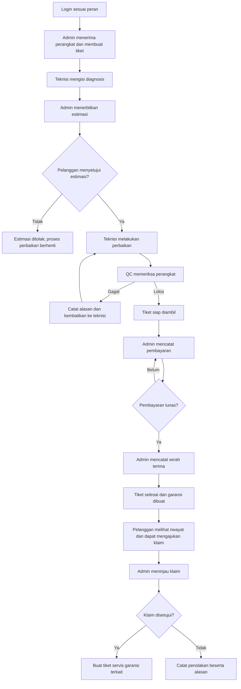

# Dokumentasi Proyek SERASI

**SERASI — Sistem Informasi Servis dan Garansi Elektronik** adalah aplikasi web untuk mengelola layanan servis perangkat elektronik dari penerimaan hingga pembayaran, serah terima, dan klaim garansi. Dokumen ini menjadi pegangan proyek, alur pengguna, metode pengembangan, serta tautan rancangan basis data.

## 1. Informasi proyek

| Aspek | Keterangan |
|---|---|
| Nama | SERASI — Sistem Informasi Servis dan Garansi Elektronik |
| Jenis | Prototipe aplikasi web interaktif untuk proyek akademik |
| Metode | Prototype secara iteratif |
| Pengguna sasaran | Pusat servis elektronik skala kecil sampai menengah |
| Perangkat yang ditangani | Laptop, ponsel, komputer, printer, dan perangkat elektronik lain |
| Bahasa dan format | Bahasa Indonesia, Rupiah (IDR), tanggal DD/MM/YYYY |
| Teknologi prototipe | HTML, CSS, JavaScript, data lokal di `localStorage` |
| Rancangan implementasi | ERD 12 entitas inti dan DDL MySQL 8/MariaDB; belum terhubung ke aplikasi |

## 2. Latar belakang

Penerimaan perangkat, diagnosis, persetujuan biaya, perbaikan, pemeriksaan kualitas, pembayaran, dan garansi sering dicatat pada tempat berbeda. Akibatnya, status terakhir, penanggung jawab, keputusan pelanggan, dan riwayat pekerjaan sulit ditelusuri.

SERASI menghubungkan proses tersebut melalui tiket servis. Setiap peran melihat pekerjaan dan informasi yang sesuai dengan tanggung jawabnya, sementara perubahan penting dicatat dalam kronologi tiket.

## 3. Tujuan

- Menyatukan data pelanggan, perangkat, tiket, diagnosis, estimasi, pekerjaan, QC, pembayaran, dan garansi.
- Menjaga proses berjalan sesuai urutan dan persetujuan yang dibutuhkan.
- Menyimpan riwayat tiap percobaan perbaikan, termasuk pengulangan setelah QC gagal.
- Membatasi tindakan dan informasi sesuai peran.
- Menyediakan pemantauan operasional yang memakai data tiket dan pembayaran yang sama.
- Menjadi media validasi kebutuhan, presentasi, dan uji kegunaan sebelum implementasi backend.

## 4. Ruang lingkup

### Termasuk

- Login simulasi berbasis peran: Admin, Teknisi, QC, Pemilik, dan Pelanggan.
- Pelanggan mendaftarkan perangkat dari menu Perangkat Saya tanpa otomatis membuat tiket servis.
- Admin menerima pelanggan/perangkat dan membuat tiket servis.
- Diagnosis dan estimasi beserta persetujuan atau penolakan pelanggan.
- Pencatatan pekerjaan perbaikan, suku cadang, dan percobaan ulang.
- Pemeriksaan QC dengan hasil lolos atau gagal.
- Pembayaran penuh atau sebagian, tagihan, dan serah terima.
- Garansi, pengajuan klaim, peninjauan, dan tiket servis lanjutan.
- Pelacakan pelanggan dan laporan Pemilik.

### Belum termasuk

- Backend, database aktif, sinkronisasi lintas perangkat, dan autentikasi produksi.
- Payment gateway, pengiriman email/WhatsApp, inventaris stok, dan integrasi pihak ketiga.
- Penyimpanan foto perangkat di cloud.

## 5. Peran dan tanggung jawab

| Peran | Tanggung jawab |
|---|---|
| Admin | Menerima perangkat, membuat tiket, menerbitkan estimasi, mencatat pembayaran dan serah terima, serta meninjau klaim. |
| Teknisi | Memeriksa perangkat, mengisi diagnosis, melaksanakan perbaikan yang disetujui, mencatat suku cadang, dan menindaklanjuti QC gagal. |
| QC | Menguji hasil perbaikan, mencatat checklist dan catatan, lalu meloloskan atau mengembalikan pekerjaan. |
| Pemilik | Memantau volume dan status tiket, keterlambatan, pendapatan, beban kerja teknisi, serta klaim garansi. |
| Pelanggan | Mendaftarkan perangkat miliknya, melacak servis, menyetujui/menolak estimasi, melihat tagihan dan garansi, serta mengajukan klaim. |

Pelanggan hanya boleh melihat data miliknya dan informasi yang memang ditujukan kepada pelanggan. Catatan internal teknisi tidak ditampilkan pada halaman pelanggan.

## 6. Alur sistem ujung ke ujung

1. **Login:** pengguna memasukkan email dan kata sandi akun perannya. Navigasi dan halaman awal mengikuti peran tersebut.
2. **Pendaftaran perangkat (opsional):** Pelanggan dapat menyimpan perangkat miliknya di menu **Perangkat Saya**. Data perangkat terhubung ke pelanggan dan belum membuat tiket servis.
3. **Penerimaan servis:** Admin memilih atau mencatat pelanggan dan perangkat, mengisi kondisi, aksesori, keluhan, prioritas, tenggat, serta teknisi. Sistem membuat tiket berstatus **Diterima**.
4. **Diagnosis:** Teknisi menyimpan temuan, dugaan penyebab, saran, kebutuhan suku cadang, biaya jasa, dan durasi. Tiket bergerak ke **Menunggu Estimasi**.
5. **Estimasi:** Admin menerbitkan versi estimasi berdasarkan diagnosis. Tiket menjadi **Menunggu Persetujuan Pelanggan**.
6. **Keputusan pelanggan:** pelanggan menyetujui atau menolak estimasi. Persetujuan membuat tiket layak dikerjakan; penolakan menghentikan alur perbaikan normal.
7. **Perbaikan:** Teknisi memulai pekerjaan setelah persetujuan. Setiap percobaan dicatat terpisah, bersama catatan kerja dan ringkasan suku cadang.
8. **QC:** QC mencatat hasil. Jika gagal, tiket kembali ke Teknisi dan percobaan berikutnya dibuat. Jika lolos, tiket menjadi **Siap Diambil**.
9. **Pembayaran:** Admin mencatat satu atau beberapa pembayaran. Status pembayaran dihitung terpisah dari status tiket.
10. **Serah terima:** setelah QC lolos dan tagihan lunas, Admin mencatat penerima dan pengakuan pelanggan. Tiket menjadi **Selesai** dan garansi dibuat.
11. **Klaim garansi:** Pelanggan memilih garansi yang tercatat dan menjelaskan masalah. Sistem memberikan pemeriksaan kelayakan awal; Admin membuat keputusan akhir dengan alasan. Klaim yang disetujui dapat menghasilkan tiket servis lanjutan.
12. **Pemantauan:** Pemilik melihat ringkasan operasional, analitik, dan laporan dari kumpulan data yang sama.

## 7. Status dan aturan bisnis

**Status tiket:** Diterima, Dalam Inspeksi, Menunggu Estimasi, Menunggu Persetujuan, Estimasi Ditolak, Menunggu Suku Cadang, Dalam Perbaikan, Menunggu QC, QC Gagal, Siap Diambil, Selesai, atau Dibatalkan.

**Status pembayaran:** Belum Dibayar, Dibayar Sebagian, atau Lunas. **Status klaim:** Diajukan, Ditinjau, Disetujui, Ditolak, Dalam Perbaikan, atau Selesai.

1. Diagnosis harus tersedia sebelum estimasi formal diterbitkan.
2. Perbaikan normal hanya boleh dimulai setelah estimasi disetujui.
3. Estimasi yang ditolak tidak boleh masuk ke pekerjaan normal.
4. Pekerjaan yang selesai harus melalui QC; teknisi tidak dapat melewati pemeriksaan.
5. QC gagal memerlukan alasan dan mengembalikan pekerjaan ke teknisi tanpa menghapus riwayat lama.
6. Serah terima mensyaratkan QC lolos dan seluruh tagihan dibayar.
7. Garansi baru tercatat setelah serah terima berhasil.
8. Klaim harus terhubung ke garansi; masa garansi adalah pemeriksaan kelayakan awal, bukan keputusan otomatis.
9. Setiap perubahan penting dicatat pada aktivitas tiket.
10. Status tiket, status pembayaran, dan status klaim tetap terpisah.

## 8. Rancangan data

Rancangan ringkas menggunakan 12 entitas: `pelanggan`, `pengguna`, `perangkat`, `tiket_servis`, `diagnosis`, `estimasi`, `aktivitas_tiket`, `pekerjaan_perbaikan`, `pemeriksaan_qc`, `pembayaran`, `garansi`, dan `klaim_garansi`.

- [ERD Chen dengan atribut oval](ERD-Chen-SERASI.md)
- [LRS (Logical Record Structure)](LRS-SERASI.md)
- [Skema MySQL 8/MariaDB](Skema-MySQL-SERASI.sql)

Perincian stok suku cadang, item QC, invoice terpisah, serah terima terpisah, serta lampiran foto belum menjadi tabel tersendiri pada rancangan ringkas.

## 9. Metode pengembangan Prototype

Pengembangan menggunakan siklus iteratif berikut:

1. **Komunikasi kebutuhan:** identifikasi masalah dan kebutuhan Admin, Teknisi, QC, Pemilik, serta Pelanggan.
2. **Perencanaan cepat:** pilih modul inti, data contoh, aturan proses, dan skenario evaluasi.
3. **Desain cepat:** buat alur sistem, rancangan layar, ERD, LRS, dan struktur navigasi.
4. **Pembuatan prototype:** implementasikan layar dan interaksi utama menggunakan data lokal.
5. **Evaluasi pengguna:** minta pengguna mencoba skenario normal dan skenario pengecualian.
6. **Perbaikan prototype:** kumpulkan umpan balik, perbaiki alur/antarmuka, lalu evaluasi ulang.
7. **Pengembangan lanjutan:** setelah rancangan disetujui, tambahkan backend, database, keamanan, dan pengujian integrasi.

Skenario evaluasi meliputi servis normal, estimasi ditolak, QC gagal dan perbaikan ulang, pembayaran sebagian, serta klaim garansi.

## 10. Akun untuk menjalankan prototype

Login merupakan simulasi frontend. Masukkan akun secara manual; seluruh akun memakai kata sandi `serasi2026`.

| Peran | Email |
|---|---|
| Admin | `maya@serasi.id` |
| Teknisi | `rizky@serasi.id` |
| QC | `nadia@serasi.id` |
| Pemilik | `bima@serasi.id` |
| Pelanggan | `andi@serasi.id` |

Pelanggan dapat mendaftarkan perangkat pada **Perangkat Saya**. Data simulasi tersimpan di `localStorage` browser.

Untuk berganti peran, keluar dari akun lalu masuk menggunakan email peran lain. Data tersimpan pada local storage browser yang sedang digunakan; perubahan tidak tersinkron otomatis dengan browser pengguna lain.

## 11. Batasan dan pengembangan berikutnya

Prototype cocok untuk demonstrasi alur dan validasi antarmuka. Akun tidak diverifikasi server, data browser dapat diubah pengguna, dan database MySQL pada dokumen belum terhubung. Tahap implementasi berikutnya perlu autentikasi dan otorisasi sisi server, database aktif, pencatatan transaksi yang aman, penyimpanan file, serta pengujian akses pelanggan.

## 12. Berkas proyek

- Prototype lokal: `outputs/repairflow/dist/index.html`
- PRD: `PRD-SERASI.md`
- ERD Chen dan rancangan data: `ERD-Chen-SERASI.md`
- LRS: `LRS-SERASI.md`
- DDL database: `Skema-MySQL-SERASI.sql`