# ERD Chen SERASI — satu diagram lengkap

**SERASI — Sistem Informasi Servis dan Garansi Elektronik**

Diagram tunggal ini memuat 12 entitas, seluruh atribut, relasi, dan kardinalitas. Persegi panjang = entitas; oval = atribut; belah ketupat = relasi. `PK` menandai primary key dan `FK` menandai foreign key. Kardinalitas memakai notasi yang umum: **1:1** (one-to-one) dan **1:N** (one-to-many). Model saat ini tidak memiliki relasi many-to-many langsung; proses berulang dimodelkan melalui entitas seperti diagnosis, pekerjaan perbaikan, QC, pembayaran, dan klaim.

Setiap primary key bernama `id`. Foreign key menggunakan nama entitas yang dirujuk, misalnya `pelanggan_id` mengacu ke `pelanggan.id` dan `tiket_servis_id` mengacu ke `tiket_servis.id`. Pendaftaran perangkat mandiri pelanggan tetap memakai relasi **Pelanggan 1:N Perangkat** yang sudah ada; atribut perangkat dilengkapi dengan tanggal pembelian dan catatan opsional. Lihat [LRS SERASI](LRS-SERASI.md) dan [DDL MySQL](Skema-MySQL-SERASI.sql) untuk rincian struktur.

> Diagram cukup besar. Gunakan zoom browser agar nama atribut terbaca.

```mermaid
flowchart LR
  subgraph g_pelanggan["PELANGGAN"]
    direction TB
    e_pelanggan["PELANGGAN"]
    a_pelanggan_1(["id · PK"]) --- e_pelanggan
    a_pelanggan_2(["nama"]) --- e_pelanggan
    a_pelanggan_3(["telepon"]) --- e_pelanggan
    a_pelanggan_4(["email"]) --- e_pelanggan
    a_pelanggan_5(["alamat"]) --- e_pelanggan
    a_pelanggan_6(["dibuat_pada"]) --- e_pelanggan
  end
  subgraph g_pengguna["PENGGUNA"]
    direction TB
    e_pengguna["PENGGUNA"]
    a_pengguna_1(["id · PK"]) --- e_pengguna
    a_pengguna_2(["nama"]) --- e_pengguna
    a_pengguna_3(["email"]) --- e_pengguna
    a_pengguna_4(["hash_kata_sandi"]) --- e_pengguna
    a_pengguna_5(["peran"]) --- e_pengguna
    a_pengguna_6(["spesialisasi"]) --- e_pengguna
    a_pengguna_7(["aktif"]) --- e_pengguna
    a_pengguna_8(["dibuat_pada"]) --- e_pengguna
  end
  subgraph g_perangkat["PERANGKAT"]
    direction TB
    e_perangkat["PERANGKAT"]
    a_perangkat_1(["id · PK"]) --- e_perangkat
    a_perangkat_2(["pelanggan_id · FK"]) --- e_perangkat
    a_perangkat_3(["kategori"]) --- e_perangkat
    a_perangkat_4(["merek"]) --- e_perangkat
    a_perangkat_5(["model"]) --- e_perangkat
    a_perangkat_6(["nomor_seri"]) --- e_perangkat
    a_perangkat_7(["tanggal_pembelian · opsional"]) --- e_perangkat
    a_perangkat_8(["catatan · opsional"]) --- e_perangkat
    a_perangkat_9(["dibuat_pada"]) --- e_perangkat
  end
  subgraph g_tiket_servis["TIKET_SERVIS"]
    direction TB
    e_tiket_servis["TIKET_SERVIS"]
    a_tiket_servis_1(["id · PK"]) --- e_tiket_servis
    a_tiket_servis_2(["nomor_tiket"]) --- e_tiket_servis
    a_tiket_servis_3(["pelanggan_id · FK"]) --- e_tiket_servis
    a_tiket_servis_4(["perangkat_id · FK"]) --- e_tiket_servis
    a_tiket_servis_5(["teknisi_id · FK"]) --- e_tiket_servis
    a_tiket_servis_6(["diterima_oleh_id · FK"]) --- e_tiket_servis
    a_tiket_servis_7(["status"]) --- e_tiket_servis
    a_tiket_servis_8(["prioritas"]) --- e_tiket_servis
    a_tiket_servis_9(["keluhan"]) --- e_tiket_servis
    a_tiket_servis_10(["kondisi_saat_diterima"]) --- e_tiket_servis
    a_tiket_servis_11(["aksesori_diterima"]) --- e_tiket_servis
    a_tiket_servis_12(["tanggal_diterima"]) --- e_tiket_servis
    a_tiket_servis_13(["target_selesai"]) --- e_tiket_servis
    a_tiket_servis_14(["tiket_servis_asal_id · FK"]) --- e_tiket_servis
    a_tiket_servis_15(["nama_penerima"]) --- e_tiket_servis
    a_tiket_servis_16(["pengakuan_pelanggan"]) --- e_tiket_servis
    a_tiket_servis_17(["diserahkan_oleh_id · FK"]) --- e_tiket_servis
    a_tiket_servis_18(["diserahkan_pada"]) --- e_tiket_servis
    a_tiket_servis_19(["dibuat_pada"]) --- e_tiket_servis
    a_tiket_servis_20(["diperbarui_pada"]) --- e_tiket_servis
  end
  subgraph g_diagnosis["DIAGNOSIS"]
    direction TB
    e_diagnosis["DIAGNOSIS"]
    a_diagnosis_1(["id · PK"]) --- e_diagnosis
    a_diagnosis_2(["tiket_servis_id · FK"]) --- e_diagnosis
    a_diagnosis_3(["teknisi_id · FK"]) --- e_diagnosis
    a_diagnosis_4(["versi"]) --- e_diagnosis
    a_diagnosis_5(["dugaan_penyebab"]) --- e_diagnosis
    a_diagnosis_6(["temuan_pemeriksaan"]) --- e_diagnosis
    a_diagnosis_7(["saran_perbaikan"]) --- e_diagnosis
    a_diagnosis_8(["estimasi_durasi_hari"]) --- e_diagnosis
    a_diagnosis_9(["dibuat_pada"]) --- e_diagnosis
  end
  subgraph g_estimasi["ESTIMASI"]
    direction TB
    e_estimasi["ESTIMASI"]
    a_estimasi_1(["id · PK"]) --- e_estimasi
    a_estimasi_2(["tiket_servis_id · FK"]) --- e_estimasi
    a_estimasi_3(["diagnosis_id · FK"]) --- e_estimasi
    a_estimasi_4(["versi"]) --- e_estimasi
    a_estimasi_5(["biaya_jasa"]) --- e_estimasi
    a_estimasi_6(["biaya_suku_cadang"]) --- e_estimasi
    a_estimasi_7(["biaya_lain"]) --- e_estimasi
    a_estimasi_8(["total"]) --- e_estimasi
    a_estimasi_9(["status"]) --- e_estimasi
    a_estimasi_10(["perkiraan_selesai"]) --- e_estimasi
    a_estimasi_11(["syarat_ketentuan"]) --- e_estimasi
    a_estimasi_12(["diterbitkan_oleh_id · FK"]) --- e_estimasi
    a_estimasi_13(["diterbitkan_pada"]) --- e_estimasi
    a_estimasi_14(["diputuskan_pada"]) --- e_estimasi
    a_estimasi_15(["alasan_keputusan"]) --- e_estimasi
    a_estimasi_16(["dibuat_pada"]) --- e_estimasi
  end
  subgraph g_aktivitas_tiket["AKTIVITAS_TIKET"]
    direction TB
    e_aktivitas_tiket["AKTIVITAS_TIKET"]
    a_aktivitas_tiket_1(["id · PK"]) --- e_aktivitas_tiket
    a_aktivitas_tiket_2(["tiket_servis_id · FK"]) --- e_aktivitas_tiket
    a_aktivitas_tiket_3(["pelaku_id · FK"]) --- e_aktivitas_tiket
    a_aktivitas_tiket_4(["nama_pelaku_saat_itu"]) --- e_aktivitas_tiket
    a_aktivitas_tiket_5(["status_sebelum"]) --- e_aktivitas_tiket
    a_aktivitas_tiket_6(["status_sesudah"]) --- e_aktivitas_tiket
    a_aktivitas_tiket_7(["deskripsi"]) --- e_aktivitas_tiket
    a_aktivitas_tiket_8(["visibilitas"]) --- e_aktivitas_tiket
    a_aktivitas_tiket_9(["terjadi_pada"]) --- e_aktivitas_tiket
  end
  subgraph g_pekerjaan_perbaikan["PEKERJAAN_PERBAIKAN"]
    direction TB
    e_pekerjaan_perbaikan["PEKERJAAN_PERBAIKAN"]
    a_pekerjaan_perbaikan_1(["id · PK"]) --- e_pekerjaan_perbaikan
    a_pekerjaan_perbaikan_2(["tiket_servis_id · FK"]) --- e_pekerjaan_perbaikan
    a_pekerjaan_perbaikan_3(["diagnosis_id · FK"]) --- e_pekerjaan_perbaikan
    a_pekerjaan_perbaikan_4(["teknisi_id · FK"]) --- e_pekerjaan_perbaikan
    a_pekerjaan_perbaikan_5(["percobaan_ke"]) --- e_pekerjaan_perbaikan
    a_pekerjaan_perbaikan_6(["status"]) --- e_pekerjaan_perbaikan
    a_pekerjaan_perbaikan_7(["catatan_internal"]) --- e_pekerjaan_perbaikan
    a_pekerjaan_perbaikan_8(["ringkasan_suku_cadang"]) --- e_pekerjaan_perbaikan
    a_pekerjaan_perbaikan_9(["dimulai_pada"]) --- e_pekerjaan_perbaikan
    a_pekerjaan_perbaikan_10(["selesai_pada"]) --- e_pekerjaan_perbaikan
  end
  subgraph g_pemeriksaan_qc["PEMERIKSAAN_QC"]
    direction TB
    e_pemeriksaan_qc["PEMERIKSAAN_QC"]
    a_pemeriksaan_qc_1(["id · PK"]) --- e_pemeriksaan_qc
    a_pemeriksaan_qc_2(["tiket_servis_id · FK"]) --- e_pemeriksaan_qc
    a_pemeriksaan_qc_3(["pekerjaan_perbaikan_id · FK"]) --- e_pemeriksaan_qc
    a_pemeriksaan_qc_4(["pemeriksa_id · FK"]) --- e_pemeriksaan_qc
    a_pemeriksaan_qc_5(["perangkat_menyala"]) --- e_pemeriksaan_qc
    a_pemeriksaan_qc_6(["keluhan_teratasi"]) --- e_pemeriksaan_qc
    a_pemeriksaan_qc_7(["fungsi_hardware_baik"]) --- e_pemeriksaan_qc
    a_pemeriksaan_qc_8(["kondisi_fisik_baik"]) --- e_pemeriksaan_qc
    a_pemeriksaan_qc_9(["aksesori_lengkap"]) --- e_pemeriksaan_qc
    a_pemeriksaan_qc_10(["hasil"]) --- e_pemeriksaan_qc
    a_pemeriksaan_qc_11(["catatan"]) --- e_pemeriksaan_qc
    a_pemeriksaan_qc_12(["diperiksa_pada"]) --- e_pemeriksaan_qc
  end
  subgraph g_pembayaran["PEMBAYARAN"]
    direction TB
    e_pembayaran["PEMBAYARAN"]
    a_pembayaran_1(["id · PK"]) --- e_pembayaran
    a_pembayaran_2(["tiket_servis_id · FK"]) --- e_pembayaran
    a_pembayaran_3(["estimasi_id · FK"]) --- e_pembayaran
    a_pembayaran_4(["dicatat_oleh_id · FK"]) --- e_pembayaran
    a_pembayaran_5(["metode"]) --- e_pembayaran
    a_pembayaran_6(["jumlah"]) --- e_pembayaran
    a_pembayaran_7(["nomor_referensi"]) --- e_pembayaran
    a_pembayaran_8(["dibayar_pada"]) --- e_pembayaran
  end
  subgraph g_garansi["GARANSI"]
    direction TB
    e_garansi["GARANSI"]
    a_garansi_1(["id · PK"]) --- e_garansi
    a_garansi_2(["nomor_garansi"]) --- e_garansi
    a_garansi_3(["tiket_servis_id · FK"]) --- e_garansi
    a_garansi_4(["tanggal_mulai"]) --- e_garansi
    a_garansi_5(["tanggal_berakhir"]) --- e_garansi
    a_garansi_6(["cakupan"]) --- e_garansi
    a_garansi_7(["status"]) --- e_garansi
    a_garansi_8(["dibuat_pada"]) --- e_garansi
  end
  subgraph g_klaim_garansi["KLAIM_GARANSI"]
    direction TB
    e_klaim_garansi["KLAIM_GARANSI"]
    a_klaim_garansi_1(["id · PK"]) --- e_klaim_garansi
    a_klaim_garansi_2(["nomor_klaim"]) --- e_klaim_garansi
    a_klaim_garansi_3(["garansi_id · FK"]) --- e_klaim_garansi
    a_klaim_garansi_4(["pelanggan_id · FK"]) --- e_klaim_garansi
    a_klaim_garansi_5(["isu_yang_dilaporkan"]) --- e_klaim_garansi
    a_klaim_garansi_6(["hasil_pemeriksaan_kelayakan"]) --- e_klaim_garansi
    a_klaim_garansi_7(["status"]) --- e_klaim_garansi
    a_klaim_garansi_8(["diajukan_pada"]) --- e_klaim_garansi
    a_klaim_garansi_9(["peninjau_id · FK"]) --- e_klaim_garansi
    a_klaim_garansi_10(["keputusan_pada"]) --- e_klaim_garansi
    a_klaim_garansi_11(["alasan_keputusan"]) --- e_klaim_garansi
    a_klaim_garansi_12(["tiket_servis_lanjutan_id · FK · UK"]) --- e_klaim_garansi
  end
  r1{"memiliki<br/>1:N"}
  e_pelanggan --- r1 --- e_perangkat
  r2{"mengajukan<br/>1:N"}
  e_pelanggan --- r2 --- e_tiket_servis
  r3{"dicatat pada<br/>1:N"}
  e_perangkat --- r3 --- e_tiket_servis
  r4{"ditugaskan ke<br/>1:N"}
  e_pengguna --- r4 --- e_tiket_servis
  r5{"menerima<br/>1:N"}
  e_pengguna --- r5 --- e_tiket_servis
  r6{"menyerahkan<br/>1:N"}
  e_pengguna --- r6 --- e_tiket_servis
  r7{"menjadi tiket asal<br/>1:N"}
  e_tiket_servis --- r7 --- e_tiket_servis
  r8{"memiliki<br/>1:N"}
  e_tiket_servis --- r8 --- e_diagnosis
  r9{"mendiagnosis<br/>1:N"}
  e_pengguna --- r9 --- e_diagnosis
  r10{"memiliki versi<br/>1:N"}
  e_tiket_servis --- r10 --- e_estimasi
  r11{"menjadi dasar<br/>1:N"}
  e_diagnosis --- r11 --- e_estimasi
  r12{"menerbitkan<br/>1:N"}
  e_pengguna --- r12 --- e_estimasi
  r13{"memiliki kronologi<br/>1:N"}
  e_tiket_servis --- r13 --- e_aktivitas_tiket
  r14{"melakukan<br/>1:N"}
  e_pengguna --- r14 --- e_aktivitas_tiket
  r15{"memiliki percobaan<br/>1:N"}
  e_tiket_servis --- r15 --- e_pekerjaan_perbaikan
  r16{"menjadi acuan<br/>1:N"}
  e_diagnosis --- r16 --- e_pekerjaan_perbaikan
  r17{"mengerjakan<br/>1:N"}
  e_pengguna --- r17 --- e_pekerjaan_perbaikan
  r18{"menjalani<br/>1:N"}
  e_tiket_servis --- r18 --- e_pemeriksaan_qc
  r19{"diperiksa melalui<br/>1:N"}
  e_pekerjaan_perbaikan --- r19 --- e_pemeriksaan_qc
  r20{"memeriksa<br/>1:N"}
  e_pengguna --- r20 --- e_pemeriksaan_qc
  r21{"memiliki pembayaran<br/>1:N"}
  e_tiket_servis --- r21 --- e_pembayaran
  r22{"menjadi acuan<br/>1:N"}
  e_estimasi --- r22 --- e_pembayaran
  r23{"mencatat<br/>1:N"}
  e_pengguna --- r23 --- e_pembayaran
  r24{"menghasilkan<br/>1:1"}
  e_tiket_servis --- r24 --- e_garansi
  r25{"menjadi dasar<br/>1:N"}
  e_garansi --- r25 --- e_klaim_garansi
  r26{"mengajukan<br/>1:N"}
  e_pelanggan --- r26 --- e_klaim_garansi
  r27{"meninjau<br/>1:N"}
  e_pengguna --- r27 --- e_klaim_garansi
  r28{"membuat tiket lanjutan<br/>1:1"}
  e_klaim_garansi --- r28 --- e_tiket_servis
  class e_pelanggan entity
  class e_pengguna entity
  class e_perangkat entity
  class e_tiket_servis entity
  class e_diagnosis entity
  class e_estimasi entity
  class e_aktivitas_tiket entity
  class e_pekerjaan_perbaikan entity
  class e_pemeriksaan_qc entity
  class e_pembayaran entity
  class e_garansi entity
  class e_klaim_garansi entity
  class a_pelanggan_1 attribute
  class a_pelanggan_2 attribute
  class a_pelanggan_3 attribute
  class a_pelanggan_4 attribute
  class a_pelanggan_5 attribute
  class a_pelanggan_6 attribute
  class a_pengguna_1 attribute
  class a_pengguna_2 attribute
  class a_pengguna_3 attribute
  class a_pengguna_4 attribute
  class a_pengguna_5 attribute
  class a_pengguna_6 attribute
  class a_pengguna_7 attribute
  class a_pengguna_8 attribute
  class a_perangkat_1 attribute
  class a_perangkat_2 attribute
  class a_perangkat_3 attribute
  class a_perangkat_4 attribute
  class a_perangkat_5 attribute
  class a_perangkat_6 attribute
  class a_perangkat_7 attribute
  class a_perangkat_8 attribute
  class a_perangkat_9 attribute
  class a_tiket_servis_1 attribute
  class a_tiket_servis_2 attribute
  class a_tiket_servis_3 attribute
  class a_tiket_servis_4 attribute
  class a_tiket_servis_5 attribute
  class a_tiket_servis_6 attribute
  class a_tiket_servis_7 attribute
  class a_tiket_servis_8 attribute
  class a_tiket_servis_9 attribute
  class a_tiket_servis_10 attribute
  class a_tiket_servis_11 attribute
  class a_tiket_servis_12 attribute
  class a_tiket_servis_13 attribute
  class a_tiket_servis_14 attribute
  class a_tiket_servis_15 attribute
  class a_tiket_servis_16 attribute
  class a_tiket_servis_17 attribute
  class a_tiket_servis_18 attribute
  class a_tiket_servis_19 attribute
  class a_tiket_servis_20 attribute
  class a_diagnosis_1 attribute
  class a_diagnosis_2 attribute
  class a_diagnosis_3 attribute
  class a_diagnosis_4 attribute
  class a_diagnosis_5 attribute
  class a_diagnosis_6 attribute
  class a_diagnosis_7 attribute
  class a_diagnosis_8 attribute
  class a_diagnosis_9 attribute
  class a_estimasi_1 attribute
  class a_estimasi_2 attribute
  class a_estimasi_3 attribute
  class a_estimasi_4 attribute
  class a_estimasi_5 attribute
  class a_estimasi_6 attribute
  class a_estimasi_7 attribute
  class a_estimasi_8 attribute
  class a_estimasi_9 attribute
  class a_estimasi_10 attribute
  class a_estimasi_11 attribute
  class a_estimasi_12 attribute
  class a_estimasi_13 attribute
  class a_estimasi_14 attribute
  class a_estimasi_15 attribute
  class a_estimasi_16 attribute
  class a_aktivitas_tiket_1 attribute
  class a_aktivitas_tiket_2 attribute
  class a_aktivitas_tiket_3 attribute
  class a_aktivitas_tiket_4 attribute
  class a_aktivitas_tiket_5 attribute
  class a_aktivitas_tiket_6 attribute
  class a_aktivitas_tiket_7 attribute
  class a_aktivitas_tiket_8 attribute
  class a_aktivitas_tiket_9 attribute
  class a_pekerjaan_perbaikan_1 attribute
  class a_pekerjaan_perbaikan_2 attribute
  class a_pekerjaan_perbaikan_3 attribute
  class a_pekerjaan_perbaikan_4 attribute
  class a_pekerjaan_perbaikan_5 attribute
  class a_pekerjaan_perbaikan_6 attribute
  class a_pekerjaan_perbaikan_7 attribute
  class a_pekerjaan_perbaikan_8 attribute
  class a_pekerjaan_perbaikan_9 attribute
  class a_pekerjaan_perbaikan_10 attribute
  class a_pemeriksaan_qc_1 attribute
  class a_pemeriksaan_qc_2 attribute
  class a_pemeriksaan_qc_3 attribute
  class a_pemeriksaan_qc_4 attribute
  class a_pemeriksaan_qc_5 attribute
  class a_pemeriksaan_qc_6 attribute
  class a_pemeriksaan_qc_7 attribute
  class a_pemeriksaan_qc_8 attribute
  class a_pemeriksaan_qc_9 attribute
  class a_pemeriksaan_qc_10 attribute
  class a_pemeriksaan_qc_11 attribute
  class a_pemeriksaan_qc_12 attribute
  class a_pembayaran_1 attribute
  class a_pembayaran_2 attribute
  class a_pembayaran_3 attribute
  class a_pembayaran_4 attribute
  class a_pembayaran_5 attribute
  class a_pembayaran_6 attribute
  class a_pembayaran_7 attribute
  class a_pembayaran_8 attribute
  class a_garansi_1 attribute
  class a_garansi_2 attribute
  class a_garansi_3 attribute
  class a_garansi_4 attribute
  class a_garansi_5 attribute
  class a_garansi_6 attribute
  class a_garansi_7 attribute
  class a_garansi_8 attribute
  class a_klaim_garansi_1 attribute
  class a_klaim_garansi_2 attribute
  class a_klaim_garansi_3 attribute
  class a_klaim_garansi_4 attribute
  class a_klaim_garansi_5 attribute
  class a_klaim_garansi_6 attribute
  class a_klaim_garansi_7 attribute
  class a_klaim_garansi_8 attribute
  class a_klaim_garansi_9 attribute
  class a_klaim_garansi_10 attribute
  class a_klaim_garansi_11 attribute
  class a_klaim_garansi_12 attribute
  class r1 relation
  class r2 relation
  class r3 relation
  class r4 relation
  class r5 relation
  class r6 relation
  class r7 relation
  class r8 relation
  class r9 relation
  class r10 relation
  class r11 relation
  class r12 relation
  class r13 relation
  class r14 relation
  class r15 relation
  class r16 relation
  class r17 relation
  class r18 relation
  class r19 relation
  class r20 relation
  class r21 relation
  class r22 relation
  class r23 relation
  class r24 relation
  class r25 relation
  class r26 relation
  class r27 relation
  class r28 relation
  classDef entity fill:#eaf1ff,stroke:#3b64cf,stroke-width:2px,color:#15284c,font-weight:bold
  classDef attribute fill:#ffffff,stroke:#6b7280,stroke-width:1px,color:#1f2937
  classDef relation fill:#fff7df,stroke:#b7791f,stroke-width:1.5px,color:#4a3410
```

