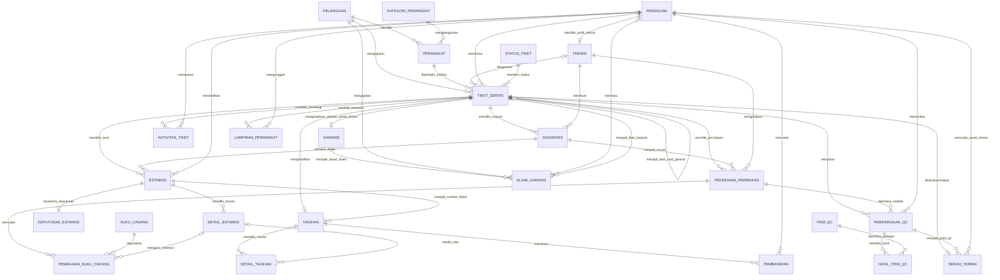
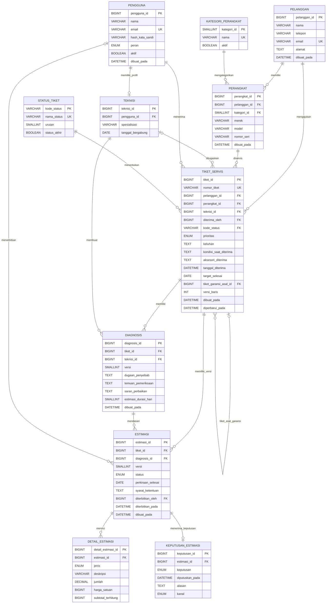
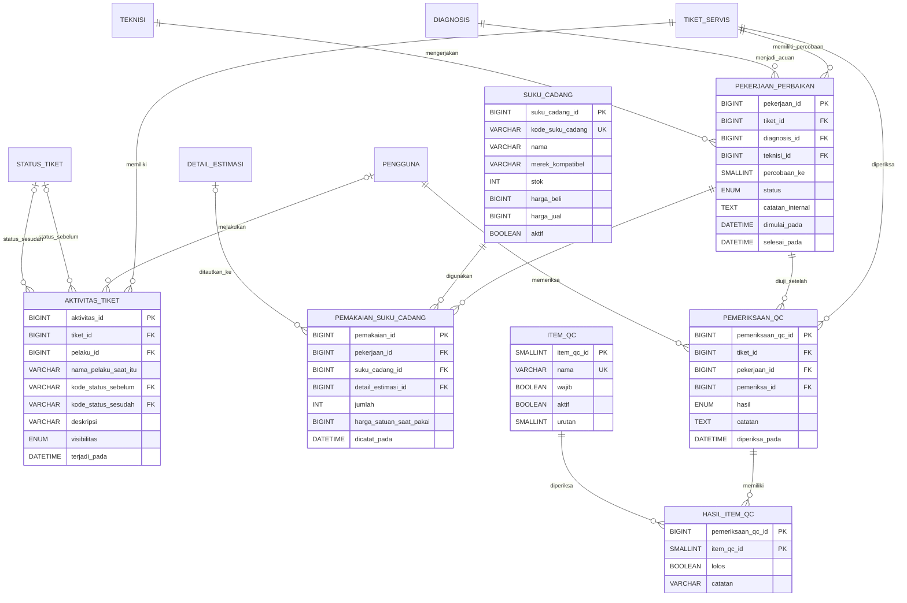
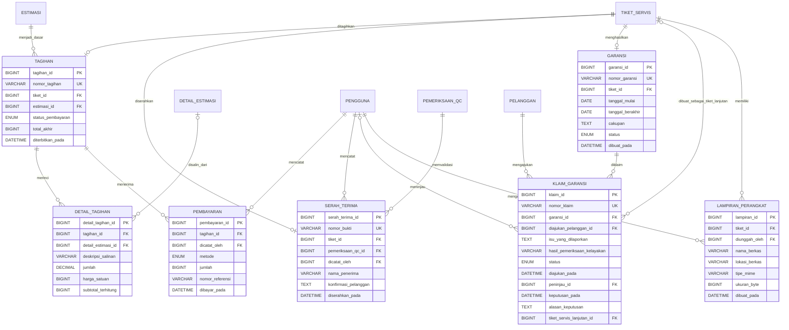
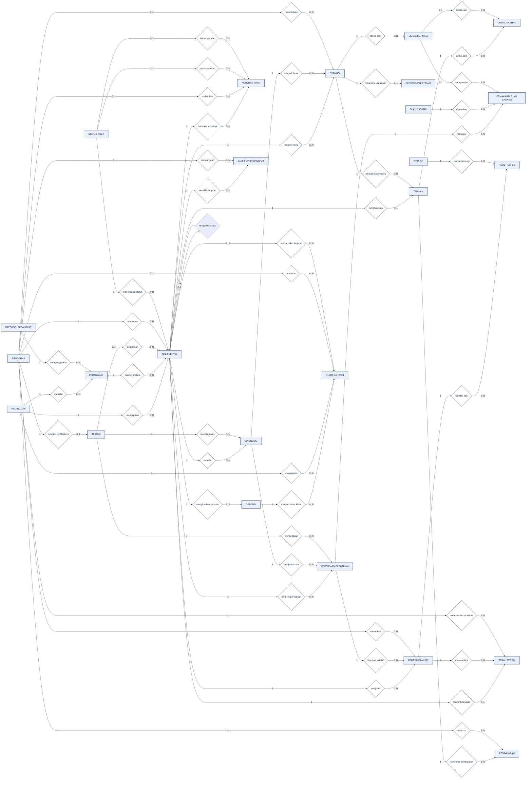

# Rancangan Basis Data SERASI

**SERASI — Sistem Informasi Servis dan Garansi Elektronik**  
Dokumen ini memetakan prototipe ke rancangan basis data relasional untuk implementasi. Asumsi DBMS: **MySQL 8 / MariaDB**. Nama tabel dan kolom menggunakan bahasa Indonesia; kode status dibuat stabil untuk logika aplikasi.

## 1. Tujuan dan batasan

Basis data harus merekam satu siklus layanan yang dapat diaudit: pelanggan menyerahkan perangkat, teknisi mendiagnosis, admin menerbitkan estimasi, pelanggan menyetujui atau menolak, teknisi memperbaiki, QC menguji, admin mencatat pembayaran dan serah terima, lalu sistem membuat garansi. Klaim garansi selalu terhubung dengan garansi dan tiket servis asal.

Prototipe saat ini memakai `localStorage` pada satu peramban. SQL terlampir adalah rancangan untuk tahap implementasi berikutnya; autentikasi, server, dan integrasi pembayaran belum dibuat.

## 2. Metode Prototype

Gunakan iterasi berikut saat menyusun laporan dan mengembangkan sistem:

1. **Komunikasi kebutuhan** — wawancarai admin, teknisi, QC, pemilik, dan pelanggan. Susun alur kerja, masalah tiap peran, serta aturan persetujuan, pembayaran, QC, dan garansi.
2. **Rencana cepat** — tentukan cakupan prototipe dan skenario uji. Contoh: tiket SER-2026-001 harus melewati diagnosis, estimasi, persetujuan pelanggan, perbaikan, QC, pembayaran, dan serah terima.
3. **Desain cepat** — buat diagram alur, ERD, kamus data, rancangan layar, serta definisi status. Validasi bahwa data yang dicatat di satu tahap dibutuhkan tahap berikutnya.
4. **Pembuatan prototype** — bangun layar dan alur yang dapat diklik dengan data simulasi. Tampilkan validasi dan aksi sesuai peran.
5. **Evaluasi pengguna** — minta perwakilan tiap peran mencoba skenario normal, estimasi ditolak, QC gagal, pembayaran sebagian, dan klaim garansi.
6. **Perbaikan prototype** — catat umpan balik, revisi layar, aturan, dan rancangan data. Ulangi evaluasi sampai alurnya mudah dipahami.
7. **Implementasi dan pengujian** — setelah prototype disetujui, implementasikan skema MySQL, autentikasi, validasi server, transaksi, dan pengujian integrasi. Prototype membantu memvalidasi kebutuhan, tetapi bukan bukti bahwa sistem produksi siap.

## 3. Entitas dan fungsi tabel

| Kelompok | Tabel | Fungsi |
|---|---|---|
| Pengguna | `pengguna`, `pelanggan`, `teknisi` | Akun staf, profil pelanggan, dan data khusus teknisi. |
| Perangkat | `kategori_perangkat`, `perangkat`, `lampiran_perangkat` | Perangkat milik pelanggan, kategori, nomor seri, kondisi, aksesori, dan foto. |
| Tiket & audit | `status_tiket`, `tiket_servis`, `aktivitas_tiket` | Identitas servis, status proses, prioritas, tenggat, serta kronologi tindakan. |
| Diagnosis & estimasi | `diagnosis`, `estimasi`, `detail_estimasi`, `keputusan_estimasi` | Temuan teknisi, versi estimasi, rincian biaya, dan keputusan pelanggan per versi. |
| Pengerjaan | `pekerjaan_perbaikan`, `suku_cadang`, `pemakaian_suku_cadang` | Percobaan pengerjaan, catatan teknisi, dan komponen yang benar-benar digunakan. |
| QC | `item_qc`, `pemeriksaan_qc`, `hasil_item_qc` | Daftar uji, hasil tiap item, keputusan lolos/gagal, dan alasan. |
| Keuangan & penyerahan | `tagihan`, `detail_tagihan`, `pembayaran`, `serah_terima` | Salinan biaya yang disetujui, pembayaran bertahap, saldo, dan bukti serah terima. |
| Garansi | `garansi`, `klaim_garansi` | Masa dan cakupan garansi serta keputusan staf atas klaim yang terhubung. |

Semua nilai uang disimpan sebagai bilangan Rupiah bulat (`BIGINT`), bukan teks berformat `Rp`. Tanggal ditampilkan `DD/MM/YYYY` pada antarmuka, tetapi disimpan sebagai `DATE` atau `DATETIME`.

## 4. Relasi ERD

ERD di bawah disusun menjadi diagram ikhtisar relasi dan diagram rinci per kelompok agar tetap terbaca. Nama entitas, kolom, PK, FK, serta kardinalitas mengikuti `Skema-MySQL-SERASI.sql`. Simbol crow's foot: `||` = tepat satu, `o|` = nol atau satu, `o{` = nol atau banyak, dan `|{` = satu atau banyak.

### 4.1 Ikhtisar seluruh relasi

### 4.2 ERD rinci — pelanggan, perangkat, tiket, dan estimasi

### 4.3 ERD rinci — aktivitas, perbaikan, dan kontrol kualitas

### 4.4 ERD rinci — tagihan, pembayaran, serah terima, dan garansi

**Catatan notasi:** `UK` berarti kolom memiliki batasan unik. Pada `teknisi.pengguna_id`, `keputusan_estimasi.estimasi_id`, `tagihan.tiket_id`, `serah_terima.tiket_id`, dan `garansi.tiket_id`, batasan `UNIQUE` ditambahkan selain FK. Kolom `hasil_item_qc.pemeriksaan_qc_id` dan `hasil_item_qc.item_qc_id` masing-masing adalah bagian PK komposit sekaligus FK. `subtotal_terhitung` adalah generated column dari `jumlah × harga_satuan`, bukan kolom yang diisi langsung. Pada ikhtisar, beberapa relasi satu-ke-banyak memiliki batasan unik tambahan di tabel anak sehingga kardinalitas nyatanya satu-ke-satu opsional, seperti tiket ke tagihan, serah terima, dan garansi.

## 5. Hubungan dan kunci utama

- Satu pelanggan dapat memiliki banyak perangkat; setiap perangkat dimiliki satu pelanggan.
- Satu tiket menunjuk satu pelanggan dan satu perangkat. Perangkat dapat memiliki riwayat banyak tiket.
- Setiap tiket mempunyai satu status proses aktif. Status pembayaran berada di tagihan, dan status klaim berada di klaim garansi; ketiganya tidak digabung.
- Diagnosis dan estimasi menggunakan nomor versi agar koreksi tidak menghapus riwayat. Keputusan persetujuan terhubung ke versi estimasi yang diputuskan.
- Satu tiket dapat mempunyai beberapa percobaan perbaikan dan pemeriksaan QC, misalnya setelah QC gagal.
- Satu tiket mempunyai paling banyak satu tagihan final dan satu catatan serah terima. Satu tagihan dapat menerima beberapa pembayaran.
- Garansi dibuat setelah serah terima. Klaim menunjuk nomor garansi asal; bila disetujui, `tiket_servis_lanjutan_id` menghubungkan servis garansi yang baru.
- Tabel aktivitas menyimpan pelaku, waktu, status sebelum/sesudah, dan tingkat visibilitas. Pelanggan hanya menerima aktivitas yang ditandai `pelanggan`.

## 6. Aturan bisnis yang dijaga

| Aturan | Penerapan yang disarankan |
|---|---|
| Diagnosis mendahului estimasi | Estimasi wajib mengacu ke `diagnosis_id` yang tersimpan. Validasi pada layanan aplikasi dan transaksi. |
| Persetujuan wajib sebelum perbaikan normal | Buat `pekerjaan_perbaikan` hanya jika keputusan untuk versi estimasi terbaru adalah `disetujui`. |
| Estimasi ditolak tidak boleh dikerjakan | Tolak perintah mulai servis pada lapisan aplikasi dan layanan; catat alasan penolakan. |
| QC gagal kembali ke teknisi | Buat hasil QC `gagal`, simpan item gagal dan alasan, lalu buka percobaan perbaikan berikutnya. |
| Serah terima memerlukan QC lolos dan pembayaran lunas | Cek pemeriksaan QC terakhir dan saldo tagihan di dalam transaksi sebelum membuat `serah_terima`. |
| Garansi hanya setelah serah terima | Buat data `garansi` dalam transaksi yang sama dengan serah terima. `UNIQUE(tiket_servis_id)` mencegah garansi ganda. |
| Klaim harus punya sumber | `klaim_garansi.garansi_id` wajib FK ke garansi yang ada. Keputusan staf dicatat terpisah dari pemeriksaan kelayakan tanggal. |
| Biaya akhir konsisten | Salin baris estimasi yang disetujui ke `detail_tagihan`. Biaya tambahan memerlukan baris persetujuan baru sebelum dimasukkan. |
| Perubahan status dapat ditelusuri | Setiap transisi penting dan keputusan menambahkan `aktivitas_tiket`; jangan menimpa catatan lama. |
| Data pelanggan terlindungi | Semua kueri portal memakai identitas pelanggan aktif sebagai filter; jangan mengandalkan penyaringan antarmuka saja. |

Aturan yang memeriksa beberapa tabel harus dijalankan dalam transaksi aplikasi, idealnya dengan mengunci baris tiket/tagihan yang sedang diproses. Constraint FK menjaga hubungan data, tetapi tidak dapat menggantikan pemeriksaan izin peran dan urutan proses.

## 7. Skenario evaluasi prototype

1. Buat tiket untuk laptop pelanggan dan pastikan nomor tiket unik.
2. Simpan diagnosis. Pastikan admin dapat melihat temuan sebelum menerbitkan estimasi.
3. Terbitkan estimasi v1. Sebelum persetujuan, teknisi tidak dapat memulai servis normal.
4. Setujui estimasi sebagai pelanggan. Teknisi dapat memulai dan mencatat suku cadang.
5. Tandai servis selesai lalu gagalkan QC. Tiket kembali ke teknisi dan belum dapat diserahterimakan.
6. Ulangi perbaikan dan loloskan QC. Catat pembayaran sebagian dan pastikan saldo masih menghalangi serah terima.
7. Lunasi tagihan, lakukan serah terima, dan pastikan nomor bukti serta garansi terbentuk.
8. Ajukan klaim dari garansi aktif dan kedaluwarsa. Sistem menunjukkan hasil pemeriksaan tanggal; staf tetap harus memberi keputusan dan alasan.
9. Masuk sebagai pelanggan dan pastikan catatan internal serta tiket pelanggan lain tidak terlihat.

## 8. Catatan implementasi

- Buat backup dan audit trail sebelum mengaktifkan penghapusan data produksi; rancangan ini memilih `RESTRICT` untuk relasi transaksi.
- Simpan foto pada penyimpanan file terpisah dan simpan URL/path serta metadata pada `lampiran_perangkat`.
- Gunakan password hash jika autentikasi sungguhan ditambahkan; jangan simpan password demo sebagai teks biasa.
- Tambahkan paginasi dan indeks tanggal/status saat jumlah tiket membesar.
- Sebelum dipakai akademik, sesuaikan istilah status, SLA, aturan pembayaran, dan masa garansi dengan kebijakan service center yang menjadi objek penelitian.

## 9. ERD kedua — notasi Chen dengan field berbentuk oval

Versi ini melengkapi Crow’s Foot di atas. Pada notasi Chen, persegi panjang adalah entitas/tabel, belah ketupat adalah relasi, dan oval adalah atribut/field. Label `PK`, `FK`, dan `UK` tetap ditampilkan pada oval field. Diagram relasi dipisah dari diagram atribut supaya tetap terbaca; seluruh 25 tabel dan kolom dari SQL dicantumkan.

### 9.1 Diagram relasi Chen

### 9.2 Field Chen (atribut oval)

Setiap diagram berikut menampilkan semua kolom dari tabel SQL sebagai oval yang terhubung ke entitasnya. Atribut bertanda `PK` adalah primary key, `FK` adalah foreign key, dan `UK` adalah kolom unik. Tipe data disertakan agar field langsung dapat dipetakan ke rancangan MySQL.

#### A. Pelanggan, perangkat, tiket, diagnosis, dan estimasi

```mermaid
flowchart LR
    subgraph G_PELANGGAN["PELANGGAN"]
        direction TB
        PELANGGAN["PELANGGAN"]
        PELANGGAN_pelanggan_id(["pelanggan_id · BIGINT UNSIGNED · PK"])
        PELANGGAN --- PELANGGAN_pelanggan_id
        PELANGGAN_nama(["nama · VARCHAR(120)"])
        PELANGGAN --- PELANGGAN_nama
        PELANGGAN_telepon(["telepon · VARCHAR(30)"])
        PELANGGAN --- PELANGGAN_telepon
        PELANGGAN_email(["email · VARCHAR(160) · UK"])
        PELANGGAN --- PELANGGAN_email
        PELANGGAN_alamat(["alamat · TEXT"])
        PELANGGAN --- PELANGGAN_alamat
        PELANGGAN_dibuat_pada(["dibuat_pada · DATETIME"])
        PELANGGAN --- PELANGGAN_dibuat_pada
    end
    subgraph G_PENGGUNA["PENGGUNA"]
        direction TB
        PENGGUNA["PENGGUNA"]
        PENGGUNA_pengguna_id(["pengguna_id · BIGINT UNSIGNED · PK"])
        PENGGUNA --- PENGGUNA_pengguna_id
        PENGGUNA_nama(["nama · VARCHAR(120)"])
        PENGGUNA --- PENGGUNA_nama
        PENGGUNA_email(["email · VARCHAR(160) · UK"])
        PENGGUNA --- PENGGUNA_email
        PENGGUNA_hash_kata_sandi(["hash_kata_sandi · VARCHAR(255)"])
        PENGGUNA --- PENGGUNA_hash_kata_sandi
        PENGGUNA_peran(["peran · ENUM('admin','teknisi','qc','pemilik')"])
        PENGGUNA --- PENGGUNA_peran
        PENGGUNA_aktif(["aktif · BOOLEAN"])
        PENGGUNA --- PENGGUNA_aktif
        PENGGUNA_dibuat_pada(["dibuat_pada · DATETIME"])
        PENGGUNA --- PENGGUNA_dibuat_pada
    end
    subgraph G_TEKNISI["TEKNISI"]
        direction TB
        TEKNISI["TEKNISI"]
        TEKNISI_teknisi_id(["teknisi_id · BIGINT UNSIGNED · PK"])
        TEKNISI --- TEKNISI_teknisi_id
        TEKNISI_pengguna_id(["pengguna_id · BIGINT UNSIGNED · FK/UK"])
        TEKNISI --- TEKNISI_pengguna_id
        TEKNISI_spesialisasi(["spesialisasi · VARCHAR(120)"])
        TEKNISI --- TEKNISI_spesialisasi
        TEKNISI_tanggal_bergabung(["tanggal_bergabung · DATE"])
        TEKNISI --- TEKNISI_tanggal_bergabung
    end
    subgraph G_KATEGORI_PERANGKAT["KATEGORI PERANGKAT"]
        direction TB
        KATEGORI_PERANGKAT["KATEGORI PERANGKAT"]
        KATEGORI_PERANGKAT_kategori_id(["kategori_id · SMALLINT UNSIGNED · PK"])
        KATEGORI_PERANGKAT --- KATEGORI_PERANGKAT_kategori_id
        KATEGORI_PERANGKAT_nama(["nama · VARCHAR(60) · UK"])
        KATEGORI_PERANGKAT --- KATEGORI_PERANGKAT_nama
        KATEGORI_PERANGKAT_aktif(["aktif · BOOLEAN"])
        KATEGORI_PERANGKAT --- KATEGORI_PERANGKAT_aktif
    end
    subgraph G_PERANGKAT["PERANGKAT"]
        direction TB
        PERANGKAT["PERANGKAT"]
        PERANGKAT_perangkat_id(["perangkat_id · BIGINT UNSIGNED · PK"])
        PERANGKAT --- PERANGKAT_perangkat_id
        PERANGKAT_pelanggan_id(["pelanggan_id · BIGINT UNSIGNED · FK"])
        PERANGKAT --- PERANGKAT_pelanggan_id
        PERANGKAT_kategori_id(["kategori_id · SMALLINT UNSIGNED · FK"])
        PERANGKAT --- PERANGKAT_kategori_id
        PERANGKAT_merek(["merek · VARCHAR(80) · UK"])
        PERANGKAT --- PERANGKAT_merek
        PERANGKAT_model(["model · VARCHAR(120)"])
        PERANGKAT --- PERANGKAT_model
        PERANGKAT_nomor_seri(["nomor_seri · VARCHAR(100) · UK"])
        PERANGKAT --- PERANGKAT_nomor_seri
        PERANGKAT_dibuat_pada(["dibuat_pada · DATETIME"])
        PERANGKAT --- PERANGKAT_dibuat_pada
    end
    subgraph G_STATUS_TIKET["STATUS TIKET"]
        direction TB
        STATUS_TIKET["STATUS TIKET"]
        STATUS_TIKET_kode_status(["kode_status · VARCHAR(32) · PK"])
        STATUS_TIKET --- STATUS_TIKET_kode_status
        STATUS_TIKET_nama_status(["nama_status · VARCHAR(60) · UK"])
        STATUS_TIKET --- STATUS_TIKET_nama_status
        STATUS_TIKET_urutan(["urutan · SMALLINT UNSIGNED"])
        STATUS_TIKET --- STATUS_TIKET_urutan
        STATUS_TIKET_status_akhir(["status_akhir · BOOLEAN"])
        STATUS_TIKET --- STATUS_TIKET_status_akhir
    end
    subgraph G_TIKET_SERVIS["TIKET SERVIS"]
        direction TB
        TIKET_SERVIS["TIKET SERVIS"]
        TIKET_SERVIS_tiket_id(["tiket_id · BIGINT UNSIGNED · PK"])
        TIKET_SERVIS --- TIKET_SERVIS_tiket_id
        TIKET_SERVIS_nomor_tiket(["nomor_tiket · VARCHAR(24) · UK"])
        TIKET_SERVIS --- TIKET_SERVIS_nomor_tiket
        TIKET_SERVIS_pelanggan_id(["pelanggan_id · BIGINT UNSIGNED · FK"])
        TIKET_SERVIS --- TIKET_SERVIS_pelanggan_id
        TIKET_SERVIS_perangkat_id(["perangkat_id · BIGINT UNSIGNED · FK"])
        TIKET_SERVIS --- TIKET_SERVIS_perangkat_id
        TIKET_SERVIS_teknisi_id(["teknisi_id · BIGINT UNSIGNED · FK"])
        TIKET_SERVIS --- TIKET_SERVIS_teknisi_id
        TIKET_SERVIS_diterima_oleh(["diterima_oleh · BIGINT UNSIGNED · FK"])
        TIKET_SERVIS --- TIKET_SERVIS_diterima_oleh
        TIKET_SERVIS_kode_status(["kode_status · VARCHAR(32) · FK"])
        TIKET_SERVIS --- TIKET_SERVIS_kode_status
        TIKET_SERVIS_prioritas(["prioritas · ENUM('rendah','normal','tinggi','mendesak')"])
        TIKET_SERVIS --- TIKET_SERVIS_prioritas
        TIKET_SERVIS_keluhan(["keluhan · TEXT"])
        TIKET_SERVIS --- TIKET_SERVIS_keluhan
        TIKET_SERVIS_kondisi_saat_diterima(["kondisi_saat_diterima · TEXT"])
        TIKET_SERVIS --- TIKET_SERVIS_kondisi_saat_diterima
        TIKET_SERVIS_aksesori_diterima(["aksesori_diterima · TEXT"])
        TIKET_SERVIS --- TIKET_SERVIS_aksesori_diterima
        TIKET_SERVIS_tanggal_diterima(["tanggal_diterima · DATETIME"])
        TIKET_SERVIS --- TIKET_SERVIS_tanggal_diterima
        TIKET_SERVIS_target_selesai(["target_selesai · DATE"])
        TIKET_SERVIS --- TIKET_SERVIS_target_selesai
        TIKET_SERVIS_tiket_garansi_asal_id(["tiket_garansi_asal_id · BIGINT UNSIGNED · FK"])
        TIKET_SERVIS --- TIKET_SERVIS_tiket_garansi_asal_id
        TIKET_SERVIS_versi_baris(["versi_baris · INT UNSIGNED"])
        TIKET_SERVIS --- TIKET_SERVIS_versi_baris
        TIKET_SERVIS_dibuat_pada(["dibuat_pada · DATETIME"])
        TIKET_SERVIS --- TIKET_SERVIS_dibuat_pada
        TIKET_SERVIS_diperbarui_pada(["diperbarui_pada · DATETIME"])
        TIKET_SERVIS --- TIKET_SERVIS_diperbarui_pada
    end
    subgraph G_DIAGNOSIS["DIAGNOSIS"]
        direction TB
        DIAGNOSIS["DIAGNOSIS"]
        DIAGNOSIS_diagnosis_id(["diagnosis_id · BIGINT UNSIGNED · PK"])
        DIAGNOSIS --- DIAGNOSIS_diagnosis_id
        DIAGNOSIS_tiket_id(["tiket_id · BIGINT UNSIGNED · FK/UK"])
        DIAGNOSIS --- DIAGNOSIS_tiket_id
        DIAGNOSIS_teknisi_id(["teknisi_id · BIGINT UNSIGNED · FK"])
        DIAGNOSIS --- DIAGNOSIS_teknisi_id
        DIAGNOSIS_versi(["versi · SMALLINT UNSIGNED · UK"])
        DIAGNOSIS --- DIAGNOSIS_versi
        DIAGNOSIS_dugaan_penyebab(["dugaan_penyebab · TEXT"])
        DIAGNOSIS --- DIAGNOSIS_dugaan_penyebab
        DIAGNOSIS_temuan_pemeriksaan(["temuan_pemeriksaan · TEXT"])
        DIAGNOSIS --- DIAGNOSIS_temuan_pemeriksaan
        DIAGNOSIS_saran_perbaikan(["saran_perbaikan · TEXT"])
        DIAGNOSIS --- DIAGNOSIS_saran_perbaikan
        DIAGNOSIS_estimasi_durasi_hari(["estimasi_durasi_hari · SMALLINT UNSIGNED"])
        DIAGNOSIS --- DIAGNOSIS_estimasi_durasi_hari
        DIAGNOSIS_dibuat_pada(["dibuat_pada · DATETIME"])
        DIAGNOSIS --- DIAGNOSIS_dibuat_pada
    end
    subgraph G_ESTIMASI["ESTIMASI"]
        direction TB
        ESTIMASI["ESTIMASI"]
        ESTIMASI_estimasi_id(["estimasi_id · BIGINT UNSIGNED · PK"])
        ESTIMASI --- ESTIMASI_estimasi_id
        ESTIMASI_tiket_id(["tiket_id · BIGINT UNSIGNED · FK/UK"])
        ESTIMASI --- ESTIMASI_tiket_id
        ESTIMASI_diagnosis_id(["diagnosis_id · BIGINT UNSIGNED · FK"])
        ESTIMASI --- ESTIMASI_diagnosis_id
        ESTIMASI_versi(["versi · SMALLINT UNSIGNED · UK"])
        ESTIMASI --- ESTIMASI_versi
        ESTIMASI_status(["status · ENUM('draf','dikirim','disetujui','ditolak','kedaluwarsa')"])
        ESTIMASI --- ESTIMASI_status
        ESTIMASI_perkiraan_selesai(["perkiraan_selesai · DATE"])
        ESTIMASI --- ESTIMASI_perkiraan_selesai
        ESTIMASI_syarat_ketentuan(["syarat_ketentuan · TEXT"])
        ESTIMASI --- ESTIMASI_syarat_ketentuan
        ESTIMASI_diterbitkan_oleh(["diterbitkan_oleh · BIGINT UNSIGNED · FK"])
        ESTIMASI --- ESTIMASI_diterbitkan_oleh
        ESTIMASI_diterbitkan_pada(["diterbitkan_pada · DATETIME"])
        ESTIMASI --- ESTIMASI_diterbitkan_pada
        ESTIMASI_dibuat_pada(["dibuat_pada · DATETIME"])
        ESTIMASI --- ESTIMASI_dibuat_pada
    end
    subgraph G_DETAIL_ESTIMASI["DETAIL ESTIMASI"]
        direction TB
        DETAIL_ESTIMASI["DETAIL ESTIMASI"]
        DETAIL_ESTIMASI_detail_estimasi_id(["detail_estimasi_id · BIGINT UNSIGNED · PK"])
        DETAIL_ESTIMASI --- DETAIL_ESTIMASI_detail_estimasi_id
        DETAIL_ESTIMASI_estimasi_id(["estimasi_id · BIGINT UNSIGNED · FK"])
        DETAIL_ESTIMASI --- DETAIL_ESTIMASI_estimasi_id
        DETAIL_ESTIMASI_jenis(["jenis · ENUM('jasa','suku_cadang','biaya_lain')"])
        DETAIL_ESTIMASI --- DETAIL_ESTIMASI_jenis
        DETAIL_ESTIMASI_deskripsi(["deskripsi · VARCHAR(200)"])
        DETAIL_ESTIMASI --- DETAIL_ESTIMASI_deskripsi
        DETAIL_ESTIMASI_jumlah(["jumlah · DECIMAL(10,2)"])
        DETAIL_ESTIMASI --- DETAIL_ESTIMASI_jumlah
        DETAIL_ESTIMASI_harga_satuan(["harga_satuan · BIGINT UNSIGNED"])
        DETAIL_ESTIMASI --- DETAIL_ESTIMASI_harga_satuan
        DETAIL_ESTIMASI_subtotal(["subtotal · BIGINT UNSIGNED"])
        DETAIL_ESTIMASI --- DETAIL_ESTIMASI_subtotal
    end
    subgraph G_KEPUTUSAN_ESTIMASI["KEPUTUSAN ESTIMASI"]
        direction TB
        KEPUTUSAN_ESTIMASI["KEPUTUSAN ESTIMASI"]
        KEPUTUSAN_ESTIMASI_keputusan_id(["keputusan_id · BIGINT UNSIGNED · PK"])
        KEPUTUSAN_ESTIMASI --- KEPUTUSAN_ESTIMASI_keputusan_id
        KEPUTUSAN_ESTIMASI_estimasi_id(["estimasi_id · BIGINT UNSIGNED · FK/UK"])
        KEPUTUSAN_ESTIMASI --- KEPUTUSAN_ESTIMASI_estimasi_id
        KEPUTUSAN_ESTIMASI_keputusan(["keputusan · ENUM('disetujui','ditolak')"])
        KEPUTUSAN_ESTIMASI --- KEPUTUSAN_ESTIMASI_keputusan
        KEPUTUSAN_ESTIMASI_diputuskan_pada(["diputuskan_pada · DATETIME"])
        KEPUTUSAN_ESTIMASI --- KEPUTUSAN_ESTIMASI_diputuskan_pada
        KEPUTUSAN_ESTIMASI_alasan(["alasan · TEXT"])
        KEPUTUSAN_ESTIMASI --- KEPUTUSAN_ESTIMASI_alasan
        KEPUTUSAN_ESTIMASI_kanal(["kanal · ENUM('portal_pelanggan','dicatat_admin')"])
        KEPUTUSAN_ESTIMASI --- KEPUTUSAN_ESTIMASI_kanal
    end
    classDef ent fill:#eaf0fb,stroke:#233e67,stroke-width:1.5px,color:#13233d
    classDef attr fill:#fff,stroke:#6680a6,stroke-width:1px,color:#1c2e4c
    class PELANGGAN ent
    class PELANGGAN_pelanggan_id attr
    class PELANGGAN_nama attr
    class PELANGGAN_telepon attr
    class PELANGGAN_email attr
    class PELANGGAN_alamat attr
    class PELANGGAN_dibuat_pada attr
    class PENGGUNA ent
    class PENGGUNA_pengguna_id attr
    class PENGGUNA_nama attr
    class PENGGUNA_email attr
    class PENGGUNA_hash_kata_sandi attr
    class PENGGUNA_peran attr
    class PENGGUNA_aktif attr
    class PENGGUNA_dibuat_pada attr
    class TEKNISI ent
    class TEKNISI_teknisi_id attr
    class TEKNISI_pengguna_id attr
    class TEKNISI_spesialisasi attr
    class TEKNISI_tanggal_bergabung attr
    class KATEGORI_PERANGKAT ent
    class KATEGORI_PERANGKAT_kategori_id attr
    class KATEGORI_PERANGKAT_nama attr
    class KATEGORI_PERANGKAT_aktif attr
    class PERANGKAT ent
    class PERANGKAT_perangkat_id attr
    class PERANGKAT_pelanggan_id attr
    class PERANGKAT_kategori_id attr
    class PERANGKAT_merek attr
    class PERANGKAT_model attr
    class PERANGKAT_nomor_seri attr
    class PERANGKAT_dibuat_pada attr
    class STATUS_TIKET ent
    class STATUS_TIKET_kode_status attr
    class STATUS_TIKET_nama_status attr
    class STATUS_TIKET_urutan attr
    class STATUS_TIKET_status_akhir attr
    class TIKET_SERVIS ent
    class TIKET_SERVIS_tiket_id attr
    class TIKET_SERVIS_nomor_tiket attr
    class TIKET_SERVIS_pelanggan_id attr
    class TIKET_SERVIS_perangkat_id attr
    class TIKET_SERVIS_teknisi_id attr
    class TIKET_SERVIS_diterima_oleh attr
    class TIKET_SERVIS_kode_status attr
    class TIKET_SERVIS_prioritas attr
    class TIKET_SERVIS_keluhan attr
    class TIKET_SERVIS_kondisi_saat_diterima attr
    class TIKET_SERVIS_aksesori_diterima attr
    class TIKET_SERVIS_tanggal_diterima attr
    class TIKET_SERVIS_target_selesai attr
    class TIKET_SERVIS_tiket_garansi_asal_id attr
    class TIKET_SERVIS_versi_baris attr
    class TIKET_SERVIS_dibuat_pada attr
    class TIKET_SERVIS_diperbarui_pada attr
    class DIAGNOSIS ent
    class DIAGNOSIS_diagnosis_id attr
    class DIAGNOSIS_tiket_id attr
    class DIAGNOSIS_teknisi_id attr
    class DIAGNOSIS_versi attr
    class DIAGNOSIS_dugaan_penyebab attr
    class DIAGNOSIS_temuan_pemeriksaan attr
    class DIAGNOSIS_saran_perbaikan attr
    class DIAGNOSIS_estimasi_durasi_hari attr
    class DIAGNOSIS_dibuat_pada attr
    class ESTIMASI ent
    class ESTIMASI_estimasi_id attr
    class ESTIMASI_tiket_id attr
    class ESTIMASI_diagnosis_id attr
    class ESTIMASI_versi attr
    class ESTIMASI_status attr
    class ESTIMASI_perkiraan_selesai attr
    class ESTIMASI_syarat_ketentuan attr
    class ESTIMASI_diterbitkan_oleh attr
    class ESTIMASI_diterbitkan_pada attr
    class ESTIMASI_dibuat_pada attr
    class DETAIL_ESTIMASI ent
    class DETAIL_ESTIMASI_detail_estimasi_id attr
    class DETAIL_ESTIMASI_estimasi_id attr
    class DETAIL_ESTIMASI_jenis attr
    class DETAIL_ESTIMASI_deskripsi attr
    class DETAIL_ESTIMASI_jumlah attr
    class DETAIL_ESTIMASI_harga_satuan attr
    class DETAIL_ESTIMASI_subtotal attr
    class KEPUTUSAN_ESTIMASI ent
    class KEPUTUSAN_ESTIMASI_keputusan_id attr
    class KEPUTUSAN_ESTIMASI_estimasi_id attr
    class KEPUTUSAN_ESTIMASI_keputusan attr
    class KEPUTUSAN_ESTIMASI_diputuskan_pada attr
    class KEPUTUSAN_ESTIMASI_alasan attr
    class KEPUTUSAN_ESTIMASI_kanal attr
```

#### B. Aktivitas, pengerjaan, suku cadang, dan QC

```mermaid
flowchart LR
    subgraph G_AKTIVITAS_TIKET["AKTIVITAS TIKET"]
        direction TB
        AKTIVITAS_TIKET["AKTIVITAS TIKET"]
        AKTIVITAS_TIKET_aktivitas_id(["aktivitas_id · BIGINT UNSIGNED · PK"])
        AKTIVITAS_TIKET --- AKTIVITAS_TIKET_aktivitas_id
        AKTIVITAS_TIKET_tiket_id(["tiket_id · BIGINT UNSIGNED · FK"])
        AKTIVITAS_TIKET --- AKTIVITAS_TIKET_tiket_id
        AKTIVITAS_TIKET_pelaku_id(["pelaku_id · BIGINT UNSIGNED · FK"])
        AKTIVITAS_TIKET --- AKTIVITAS_TIKET_pelaku_id
        AKTIVITAS_TIKET_nama_pelaku_saat_itu(["nama_pelaku_saat_itu · VARCHAR(120)"])
        AKTIVITAS_TIKET --- AKTIVITAS_TIKET_nama_pelaku_saat_itu
        AKTIVITAS_TIKET_kode_status_sebelum(["kode_status_sebelum · VARCHAR(32) · FK"])
        AKTIVITAS_TIKET --- AKTIVITAS_TIKET_kode_status_sebelum
        AKTIVITAS_TIKET_kode_status_sesudah(["kode_status_sesudah · VARCHAR(32) · FK"])
        AKTIVITAS_TIKET --- AKTIVITAS_TIKET_kode_status_sesudah
        AKTIVITAS_TIKET_deskripsi(["deskripsi · VARCHAR(500)"])
        AKTIVITAS_TIKET --- AKTIVITAS_TIKET_deskripsi
        AKTIVITAS_TIKET_visibilitas(["visibilitas · ENUM('internal','pelanggan')"])
        AKTIVITAS_TIKET --- AKTIVITAS_TIKET_visibilitas
        AKTIVITAS_TIKET_terjadi_pada(["terjadi_pada · DATETIME"])
        AKTIVITAS_TIKET --- AKTIVITAS_TIKET_terjadi_pada
    end
    subgraph G_PEKERJAAN_PERBAIKAN["PEKERJAAN PERBAIKAN"]
        direction TB
        PEKERJAAN_PERBAIKAN["PEKERJAAN PERBAIKAN"]
        PEKERJAAN_PERBAIKAN_pekerjaan_id(["pekerjaan_id · BIGINT UNSIGNED · PK"])
        PEKERJAAN_PERBAIKAN --- PEKERJAAN_PERBAIKAN_pekerjaan_id
        PEKERJAAN_PERBAIKAN_tiket_id(["tiket_id · BIGINT UNSIGNED · FK/UK"])
        PEKERJAAN_PERBAIKAN --- PEKERJAAN_PERBAIKAN_tiket_id
        PEKERJAAN_PERBAIKAN_diagnosis_id(["diagnosis_id · BIGINT UNSIGNED · FK"])
        PEKERJAAN_PERBAIKAN --- PEKERJAAN_PERBAIKAN_diagnosis_id
        PEKERJAAN_PERBAIKAN_teknisi_id(["teknisi_id · BIGINT UNSIGNED · FK"])
        PEKERJAAN_PERBAIKAN --- PEKERJAAN_PERBAIKAN_teknisi_id
        PEKERJAAN_PERBAIKAN_percobaan_ke(["percobaan_ke · SMALLINT UNSIGNED · UK"])
        PEKERJAAN_PERBAIKAN --- PEKERJAAN_PERBAIKAN_percobaan_ke
        PEKERJAAN_PERBAIKAN_status(["status · ENUM('berjalan','selesai','dikembalikan_qc')"])
        PEKERJAAN_PERBAIKAN --- PEKERJAAN_PERBAIKAN_status
        PEKERJAAN_PERBAIKAN_catatan_internal(["catatan_internal · TEXT"])
        PEKERJAAN_PERBAIKAN --- PEKERJAAN_PERBAIKAN_catatan_internal
        PEKERJAAN_PERBAIKAN_dimulai_pada(["dimulai_pada · DATETIME"])
        PEKERJAAN_PERBAIKAN --- PEKERJAAN_PERBAIKAN_dimulai_pada
        PEKERJAAN_PERBAIKAN_selesai_pada(["selesai_pada · DATETIME"])
        PEKERJAAN_PERBAIKAN --- PEKERJAAN_PERBAIKAN_selesai_pada
    end
    subgraph G_SUKU_CADANG["SUKU CADANG"]
        direction TB
        SUKU_CADANG["SUKU CADANG"]
        SUKU_CADANG_suku_cadang_id(["suku_cadang_id · BIGINT UNSIGNED · PK"])
        SUKU_CADANG --- SUKU_CADANG_suku_cadang_id
        SUKU_CADANG_kode_suku_cadang(["kode_suku_cadang · VARCHAR(40) · UK"])
        SUKU_CADANG --- SUKU_CADANG_kode_suku_cadang
        SUKU_CADANG_nama(["nama · VARCHAR(160)"])
        SUKU_CADANG --- SUKU_CADANG_nama
        SUKU_CADANG_merek_kompatibel(["merek_kompatibel · VARCHAR(100)"])
        SUKU_CADANG --- SUKU_CADANG_merek_kompatibel
        SUKU_CADANG_stok(["stok · INT UNSIGNED"])
        SUKU_CADANG --- SUKU_CADANG_stok
        SUKU_CADANG_harga_beli(["harga_beli · BIGINT UNSIGNED"])
        SUKU_CADANG --- SUKU_CADANG_harga_beli
        SUKU_CADANG_harga_jual(["harga_jual · BIGINT UNSIGNED"])
        SUKU_CADANG --- SUKU_CADANG_harga_jual
        SUKU_CADANG_aktif(["aktif · BOOLEAN"])
        SUKU_CADANG --- SUKU_CADANG_aktif
    end
    subgraph G_PEMAKAIAN_SUKU_CADANG["PEMAKAIAN SUKU CADANG"]
        direction TB
        PEMAKAIAN_SUKU_CADANG["PEMAKAIAN SUKU CADANG"]
        PEMAKAIAN_SUKU_CADANG_pemakaian_id(["pemakaian_id · BIGINT UNSIGNED · PK"])
        PEMAKAIAN_SUKU_CADANG --- PEMAKAIAN_SUKU_CADANG_pemakaian_id
        PEMAKAIAN_SUKU_CADANG_pekerjaan_id(["pekerjaan_id · BIGINT UNSIGNED · FK"])
        PEMAKAIAN_SUKU_CADANG --- PEMAKAIAN_SUKU_CADANG_pekerjaan_id
        PEMAKAIAN_SUKU_CADANG_suku_cadang_id(["suku_cadang_id · BIGINT UNSIGNED · FK"])
        PEMAKAIAN_SUKU_CADANG --- PEMAKAIAN_SUKU_CADANG_suku_cadang_id
        PEMAKAIAN_SUKU_CADANG_detail_estimasi_id(["detail_estimasi_id · BIGINT UNSIGNED · FK"])
        PEMAKAIAN_SUKU_CADANG --- PEMAKAIAN_SUKU_CADANG_detail_estimasi_id
        PEMAKAIAN_SUKU_CADANG_jumlah(["jumlah · INT UNSIGNED"])
        PEMAKAIAN_SUKU_CADANG --- PEMAKAIAN_SUKU_CADANG_jumlah
        PEMAKAIAN_SUKU_CADANG_harga_satuan_saat_pakai(["harga_satuan_saat_pakai · BIGINT UNSIGNED"])
        PEMAKAIAN_SUKU_CADANG --- PEMAKAIAN_SUKU_CADANG_harga_satuan_saat_pakai
        PEMAKAIAN_SUKU_CADANG_dicatat_pada(["dicatat_pada · DATETIME"])
        PEMAKAIAN_SUKU_CADANG --- PEMAKAIAN_SUKU_CADANG_dicatat_pada
    end
    subgraph G_ITEM_QC["ITEM QC"]
        direction TB
        ITEM_QC["ITEM QC"]
        ITEM_QC_item_qc_id(["item_qc_id · SMALLINT UNSIGNED · PK"])
        ITEM_QC --- ITEM_QC_item_qc_id
        ITEM_QC_nama(["nama · VARCHAR(160) · UK"])
        ITEM_QC --- ITEM_QC_nama
        ITEM_QC_wajib(["wajib · BOOLEAN"])
        ITEM_QC --- ITEM_QC_wajib
        ITEM_QC_aktif(["aktif · BOOLEAN"])
        ITEM_QC --- ITEM_QC_aktif
        ITEM_QC_urutan(["urutan · SMALLINT UNSIGNED"])
        ITEM_QC --- ITEM_QC_urutan
    end
    subgraph G_PEMERIKSAAN_QC["PEMERIKSAAN QC"]
        direction TB
        PEMERIKSAAN_QC["PEMERIKSAAN QC"]
        PEMERIKSAAN_QC_pemeriksaan_qc_id(["pemeriksaan_qc_id · BIGINT UNSIGNED · PK"])
        PEMERIKSAAN_QC --- PEMERIKSAAN_QC_pemeriksaan_qc_id
        PEMERIKSAAN_QC_tiket_id(["tiket_id · BIGINT UNSIGNED · FK"])
        PEMERIKSAAN_QC --- PEMERIKSAAN_QC_tiket_id
        PEMERIKSAAN_QC_pekerjaan_id(["pekerjaan_id · BIGINT UNSIGNED · FK"])
        PEMERIKSAAN_QC --- PEMERIKSAAN_QC_pekerjaan_id
        PEMERIKSAAN_QC_pemeriksa_id(["pemeriksa_id · BIGINT UNSIGNED · FK"])
        PEMERIKSAAN_QC --- PEMERIKSAAN_QC_pemeriksa_id
        PEMERIKSAAN_QC_hasil(["hasil · ENUM('lolos','gagal')"])
        PEMERIKSAAN_QC --- PEMERIKSAAN_QC_hasil
        PEMERIKSAAN_QC_catatan(["catatan · TEXT"])
        PEMERIKSAAN_QC --- PEMERIKSAAN_QC_catatan
        PEMERIKSAAN_QC_diperiksa_pada(["diperiksa_pada · DATETIME"])
        PEMERIKSAAN_QC --- PEMERIKSAAN_QC_diperiksa_pada
    end
    subgraph G_HASIL_ITEM_QC["HASIL ITEM QC"]
        direction TB
        HASIL_ITEM_QC["HASIL ITEM QC"]
        HASIL_ITEM_QC_pemeriksaan_qc_id(["pemeriksaan_qc_id · BIGINT UNSIGNED · PK/FK"])
        HASIL_ITEM_QC --- HASIL_ITEM_QC_pemeriksaan_qc_id
        HASIL_ITEM_QC_item_qc_id(["item_qc_id · SMALLINT UNSIGNED · PK/FK"])
        HASIL_ITEM_QC --- HASIL_ITEM_QC_item_qc_id
        HASIL_ITEM_QC_lolos(["lolos · BOOLEAN"])
        HASIL_ITEM_QC --- HASIL_ITEM_QC_lolos
        HASIL_ITEM_QC_catatan(["catatan · VARCHAR(300)"])
        HASIL_ITEM_QC --- HASIL_ITEM_QC_catatan
    end
    classDef ent fill:#eaf0fb,stroke:#233e67,stroke-width:1.5px,color:#13233d
    classDef attr fill:#fff,stroke:#6680a6,stroke-width:1px,color:#1c2e4c
    class AKTIVITAS_TIKET ent
    class AKTIVITAS_TIKET_aktivitas_id attr
    class AKTIVITAS_TIKET_tiket_id attr
    class AKTIVITAS_TIKET_pelaku_id attr
    class AKTIVITAS_TIKET_nama_pelaku_saat_itu attr
    class AKTIVITAS_TIKET_kode_status_sebelum attr
    class AKTIVITAS_TIKET_kode_status_sesudah attr
    class AKTIVITAS_TIKET_deskripsi attr
    class AKTIVITAS_TIKET_visibilitas attr
    class AKTIVITAS_TIKET_terjadi_pada attr
    class PEKERJAAN_PERBAIKAN ent
    class PEKERJAAN_PERBAIKAN_pekerjaan_id attr
    class PEKERJAAN_PERBAIKAN_tiket_id attr
    class PEKERJAAN_PERBAIKAN_diagnosis_id attr
    class PEKERJAAN_PERBAIKAN_teknisi_id attr
    class PEKERJAAN_PERBAIKAN_percobaan_ke attr
    class PEKERJAAN_PERBAIKAN_status attr
    class PEKERJAAN_PERBAIKAN_catatan_internal attr
    class PEKERJAAN_PERBAIKAN_dimulai_pada attr
    class PEKERJAAN_PERBAIKAN_selesai_pada attr
    class SUKU_CADANG ent
    class SUKU_CADANG_suku_cadang_id attr
    class SUKU_CADANG_kode_suku_cadang attr
    class SUKU_CADANG_nama attr
    class SUKU_CADANG_merek_kompatibel attr
    class SUKU_CADANG_stok attr
    class SUKU_CADANG_harga_beli attr
    class SUKU_CADANG_harga_jual attr
    class SUKU_CADANG_aktif attr
    class PEMAKAIAN_SUKU_CADANG ent
    class PEMAKAIAN_SUKU_CADANG_pemakaian_id attr
    class PEMAKAIAN_SUKU_CADANG_pekerjaan_id attr
    class PEMAKAIAN_SUKU_CADANG_suku_cadang_id attr
    class PEMAKAIAN_SUKU_CADANG_detail_estimasi_id attr
    class PEMAKAIAN_SUKU_CADANG_jumlah attr
    class PEMAKAIAN_SUKU_CADANG_harga_satuan_saat_pakai attr
    class PEMAKAIAN_SUKU_CADANG_dicatat_pada attr
    class ITEM_QC ent
    class ITEM_QC_item_qc_id attr
    class ITEM_QC_nama attr
    class ITEM_QC_wajib attr
    class ITEM_QC_aktif attr
    class ITEM_QC_urutan attr
    class PEMERIKSAAN_QC ent
    class PEMERIKSAAN_QC_pemeriksaan_qc_id attr
    class PEMERIKSAAN_QC_tiket_id attr
    class PEMERIKSAAN_QC_pekerjaan_id attr
    class PEMERIKSAAN_QC_pemeriksa_id attr
    class PEMERIKSAAN_QC_hasil attr
    class PEMERIKSAAN_QC_catatan attr
    class PEMERIKSAAN_QC_diperiksa_pada attr
    class HASIL_ITEM_QC ent
    class HASIL_ITEM_QC_pemeriksaan_qc_id attr
    class HASIL_ITEM_QC_item_qc_id attr
    class HASIL_ITEM_QC_lolos attr
    class HASIL_ITEM_QC_catatan attr
```

#### C. Tagihan, pembayaran, serah terima, garansi, dan lampiran

```mermaid
flowchart LR
    subgraph G_TAGIHAN["TAGIHAN"]
        direction TB
        TAGIHAN["TAGIHAN"]
        TAGIHAN_tagihan_id(["tagihan_id · BIGINT UNSIGNED · PK"])
        TAGIHAN --- TAGIHAN_tagihan_id
        TAGIHAN_nomor_tagihan(["nomor_tagihan · VARCHAR(32) · UK"])
        TAGIHAN --- TAGIHAN_nomor_tagihan
        TAGIHAN_tiket_id(["tiket_id · BIGINT UNSIGNED · FK/UK"])
        TAGIHAN --- TAGIHAN_tiket_id
        TAGIHAN_estimasi_id(["estimasi_id · BIGINT UNSIGNED · FK"])
        TAGIHAN --- TAGIHAN_estimasi_id
        TAGIHAN_status_pembayaran(["status_pembayaran · ENUM('belum_dibayar','dibayar_sebagian','lunas')"])
        TAGIHAN --- TAGIHAN_status_pembayaran
        TAGIHAN_total_akhir(["total_akhir · BIGINT UNSIGNED"])
        TAGIHAN --- TAGIHAN_total_akhir
        TAGIHAN_diterbitkan_pada(["diterbitkan_pada · DATETIME"])
        TAGIHAN --- TAGIHAN_diterbitkan_pada
    end
    subgraph G_DETAIL_TAGIHAN["DETAIL TAGIHAN"]
        direction TB
        DETAIL_TAGIHAN["DETAIL TAGIHAN"]
        DETAIL_TAGIHAN_detail_tagihan_id(["detail_tagihan_id · BIGINT UNSIGNED · PK"])
        DETAIL_TAGIHAN --- DETAIL_TAGIHAN_detail_tagihan_id
        DETAIL_TAGIHAN_tagihan_id(["tagihan_id · BIGINT UNSIGNED · FK"])
        DETAIL_TAGIHAN --- DETAIL_TAGIHAN_tagihan_id
        DETAIL_TAGIHAN_detail_estimasi_id(["detail_estimasi_id · BIGINT UNSIGNED · FK"])
        DETAIL_TAGIHAN --- DETAIL_TAGIHAN_detail_estimasi_id
        DETAIL_TAGIHAN_deskripsi_salinan(["deskripsi_salinan · VARCHAR(200)"])
        DETAIL_TAGIHAN --- DETAIL_TAGIHAN_deskripsi_salinan
        DETAIL_TAGIHAN_jumlah(["jumlah · DECIMAL(10,2)"])
        DETAIL_TAGIHAN --- DETAIL_TAGIHAN_jumlah
        DETAIL_TAGIHAN_harga_satuan(["harga_satuan · BIGINT UNSIGNED"])
        DETAIL_TAGIHAN --- DETAIL_TAGIHAN_harga_satuan
        DETAIL_TAGIHAN_subtotal(["subtotal · BIGINT UNSIGNED"])
        DETAIL_TAGIHAN --- DETAIL_TAGIHAN_subtotal
    end
    subgraph G_PEMBAYARAN["PEMBAYARAN"]
        direction TB
        PEMBAYARAN["PEMBAYARAN"]
        PEMBAYARAN_pembayaran_id(["pembayaran_id · BIGINT UNSIGNED · PK"])
        PEMBAYARAN --- PEMBAYARAN_pembayaran_id
        PEMBAYARAN_tagihan_id(["tagihan_id · BIGINT UNSIGNED · FK"])
        PEMBAYARAN --- PEMBAYARAN_tagihan_id
        PEMBAYARAN_dicatat_oleh(["dicatat_oleh · BIGINT UNSIGNED · FK"])
        PEMBAYARAN --- PEMBAYARAN_dicatat_oleh
        PEMBAYARAN_metode(["metode · ENUM('tunai','transfer_bank','qris','kartu_debit','lainnya')"])
        PEMBAYARAN --- PEMBAYARAN_metode
        PEMBAYARAN_jumlah(["jumlah · BIGINT UNSIGNED"])
        PEMBAYARAN --- PEMBAYARAN_jumlah
        PEMBAYARAN_nomor_referensi(["nomor_referensi · VARCHAR(100)"])
        PEMBAYARAN --- PEMBAYARAN_nomor_referensi
        PEMBAYARAN_dibayar_pada(["dibayar_pada · DATETIME"])
        PEMBAYARAN --- PEMBAYARAN_dibayar_pada
    end
    subgraph G_SERAH_TERIMA["SERAH TERIMA"]
        direction TB
        SERAH_TERIMA["SERAH TERIMA"]
        SERAH_TERIMA_serah_terima_id(["serah_terima_id · BIGINT UNSIGNED · PK"])
        SERAH_TERIMA --- SERAH_TERIMA_serah_terima_id
        SERAH_TERIMA_nomor_bukti(["nomor_bukti · VARCHAR(32) · UK"])
        SERAH_TERIMA --- SERAH_TERIMA_nomor_bukti
        SERAH_TERIMA_tiket_id(["tiket_id · BIGINT UNSIGNED · FK/UK"])
        SERAH_TERIMA --- SERAH_TERIMA_tiket_id
        SERAH_TERIMA_pemeriksaan_qc_id(["pemeriksaan_qc_id · BIGINT UNSIGNED · FK"])
        SERAH_TERIMA --- SERAH_TERIMA_pemeriksaan_qc_id
        SERAH_TERIMA_dicatat_oleh(["dicatat_oleh · BIGINT UNSIGNED · FK"])
        SERAH_TERIMA --- SERAH_TERIMA_dicatat_oleh
        SERAH_TERIMA_nama_penerima(["nama_penerima · VARCHAR(120)"])
        SERAH_TERIMA --- SERAH_TERIMA_nama_penerima
        SERAH_TERIMA_konfirmasi_pelanggan(["konfirmasi_pelanggan · TEXT"])
        SERAH_TERIMA --- SERAH_TERIMA_konfirmasi_pelanggan
        SERAH_TERIMA_diserahkan_pada(["diserahkan_pada · DATETIME"])
        SERAH_TERIMA --- SERAH_TERIMA_diserahkan_pada
    end
    subgraph G_GARANSI["GARANSI"]
        direction TB
        GARANSI["GARANSI"]
        GARANSI_garansi_id(["garansi_id · BIGINT UNSIGNED · PK"])
        GARANSI --- GARANSI_garansi_id
        GARANSI_nomor_garansi(["nomor_garansi · VARCHAR(32) · UK"])
        GARANSI --- GARANSI_nomor_garansi
        GARANSI_tiket_id(["tiket_id · BIGINT UNSIGNED · FK/UK"])
        GARANSI --- GARANSI_tiket_id
        GARANSI_tanggal_mulai(["tanggal_mulai · DATE"])
        GARANSI --- GARANSI_tanggal_mulai
        GARANSI_tanggal_berakhir(["tanggal_berakhir · DATE"])
        GARANSI --- GARANSI_tanggal_berakhir
        GARANSI_cakupan(["cakupan · TEXT"])
        GARANSI --- GARANSI_cakupan
        GARANSI_status(["status · ENUM('aktif','kedaluwarsa','dicabut')"])
        GARANSI --- GARANSI_status
        GARANSI_dibuat_pada(["dibuat_pada · DATETIME"])
        GARANSI --- GARANSI_dibuat_pada
    end
    subgraph G_KLAIM_GARANSI["KLAIM GARANSI"]
        direction TB
        KLAIM_GARANSI["KLAIM GARANSI"]
        KLAIM_GARANSI_klaim_id(["klaim_id · BIGINT UNSIGNED · PK"])
        KLAIM_GARANSI --- KLAIM_GARANSI_klaim_id
        KLAIM_GARANSI_nomor_klaim(["nomor_klaim · VARCHAR(32) · UK"])
        KLAIM_GARANSI --- KLAIM_GARANSI_nomor_klaim
        KLAIM_GARANSI_garansi_id(["garansi_id · BIGINT UNSIGNED · FK"])
        KLAIM_GARANSI --- KLAIM_GARANSI_garansi_id
        KLAIM_GARANSI_diajukan_pelanggan_id(["diajukan_pelanggan_id · BIGINT UNSIGNED · FK"])
        KLAIM_GARANSI --- KLAIM_GARANSI_diajukan_pelanggan_id
        KLAIM_GARANSI_isu_yang_dilaporkan(["isu_yang_dilaporkan · TEXT"])
        KLAIM_GARANSI --- KLAIM_GARANSI_isu_yang_dilaporkan
        KLAIM_GARANSI_hasil_pemeriksaan_kelayakan(["hasil_pemeriksaan_kelayakan · VARCHAR(300)"])
        KLAIM_GARANSI --- KLAIM_GARANSI_hasil_pemeriksaan_kelayakan
        KLAIM_GARANSI_status(["status · ENUM('diajukan','ditinjau','disetujui','ditolak','dalam_perbaikan','selesai')"])
        KLAIM_GARANSI --- KLAIM_GARANSI_status
        KLAIM_GARANSI_diajukan_pada(["diajukan_pada · DATETIME"])
        KLAIM_GARANSI --- KLAIM_GARANSI_diajukan_pada
        KLAIM_GARANSI_peninjau_id(["peninjau_id · BIGINT UNSIGNED · FK"])
        KLAIM_GARANSI --- KLAIM_GARANSI_peninjau_id
        KLAIM_GARANSI_keputusan_pada(["keputusan_pada · DATETIME"])
        KLAIM_GARANSI --- KLAIM_GARANSI_keputusan_pada
        KLAIM_GARANSI_alasan_keputusan(["alasan_keputusan · TEXT"])
        KLAIM_GARANSI --- KLAIM_GARANSI_alasan_keputusan
        KLAIM_GARANSI_tiket_servis_lanjutan_id(["tiket_servis_lanjutan_id · BIGINT UNSIGNED · FK"])
        KLAIM_GARANSI --- KLAIM_GARANSI_tiket_servis_lanjutan_id
    end
    subgraph G_LAMPIRAN_PERANGKAT["LAMPIRAN PERANGKAT"]
        direction TB
        LAMPIRAN_PERANGKAT["LAMPIRAN PERANGKAT"]
        LAMPIRAN_PERANGKAT_lampiran_id(["lampiran_id · BIGINT UNSIGNED · PK"])
        LAMPIRAN_PERANGKAT --- LAMPIRAN_PERANGKAT_lampiran_id
        LAMPIRAN_PERANGKAT_tiket_id(["tiket_id · BIGINT UNSIGNED · FK"])
        LAMPIRAN_PERANGKAT --- LAMPIRAN_PERANGKAT_tiket_id
        LAMPIRAN_PERANGKAT_diunggah_oleh(["diunggah_oleh · BIGINT UNSIGNED · FK"])
        LAMPIRAN_PERANGKAT --- LAMPIRAN_PERANGKAT_diunggah_oleh
        LAMPIRAN_PERANGKAT_nama_berkas(["nama_berkas · VARCHAR(255)"])
        LAMPIRAN_PERANGKAT --- LAMPIRAN_PERANGKAT_nama_berkas
        LAMPIRAN_PERANGKAT_lokasi_berkas(["lokasi_berkas · VARCHAR(500)"])
        LAMPIRAN_PERANGKAT --- LAMPIRAN_PERANGKAT_lokasi_berkas
        LAMPIRAN_PERANGKAT_tipe_mime(["tipe_mime · VARCHAR(100)"])
        LAMPIRAN_PERANGKAT --- LAMPIRAN_PERANGKAT_tipe_mime
        LAMPIRAN_PERANGKAT_ukuran_byte(["ukuran_byte · BIGINT UNSIGNED"])
        LAMPIRAN_PERANGKAT --- LAMPIRAN_PERANGKAT_ukuran_byte
        LAMPIRAN_PERANGKAT_dibuat_pada(["dibuat_pada · DATETIME"])
        LAMPIRAN_PERANGKAT --- LAMPIRAN_PERANGKAT_dibuat_pada
    end
    classDef ent fill:#eaf0fb,stroke:#233e67,stroke-width:1.5px,color:#13233d
    classDef attr fill:#fff,stroke:#6680a6,stroke-width:1px,color:#1c2e4c
    class TAGIHAN ent
    class TAGIHAN_tagihan_id attr
    class TAGIHAN_nomor_tagihan attr
    class TAGIHAN_tiket_id attr
    class TAGIHAN_estimasi_id attr
    class TAGIHAN_status_pembayaran attr
    class TAGIHAN_total_akhir attr
    class TAGIHAN_diterbitkan_pada attr
    class DETAIL_TAGIHAN ent
    class DETAIL_TAGIHAN_detail_tagihan_id attr
    class DETAIL_TAGIHAN_tagihan_id attr
    class DETAIL_TAGIHAN_detail_estimasi_id attr
    class DETAIL_TAGIHAN_deskripsi_salinan attr
    class DETAIL_TAGIHAN_jumlah attr
    class DETAIL_TAGIHAN_harga_satuan attr
    class DETAIL_TAGIHAN_subtotal attr
    class PEMBAYARAN ent
    class PEMBAYARAN_pembayaran_id attr
    class PEMBAYARAN_tagihan_id attr
    class PEMBAYARAN_dicatat_oleh attr
    class PEMBAYARAN_metode attr
    class PEMBAYARAN_jumlah attr
    class PEMBAYARAN_nomor_referensi attr
    class PEMBAYARAN_dibayar_pada attr
    class SERAH_TERIMA ent
    class SERAH_TERIMA_serah_terima_id attr
    class SERAH_TERIMA_nomor_bukti attr
    class SERAH_TERIMA_tiket_id attr
    class SERAH_TERIMA_pemeriksaan_qc_id attr
    class SERAH_TERIMA_dicatat_oleh attr
    class SERAH_TERIMA_nama_penerima attr
    class SERAH_TERIMA_konfirmasi_pelanggan attr
    class SERAH_TERIMA_diserahkan_pada attr
    class GARANSI ent
    class GARANSI_garansi_id attr
    class GARANSI_nomor_garansi attr
    class GARANSI_tiket_id attr
    class GARANSI_tanggal_mulai attr
    class GARANSI_tanggal_berakhir attr
    class GARANSI_cakupan attr
    class GARANSI_status attr
    class GARANSI_dibuat_pada attr
    class KLAIM_GARANSI ent
    class KLAIM_GARANSI_klaim_id attr
    class KLAIM_GARANSI_nomor_klaim attr
    class KLAIM_GARANSI_garansi_id attr
    class KLAIM_GARANSI_diajukan_pelanggan_id attr
    class KLAIM_GARANSI_isu_yang_dilaporkan attr
    class KLAIM_GARANSI_hasil_pemeriksaan_kelayakan attr
    class KLAIM_GARANSI_status attr
    class KLAIM_GARANSI_diajukan_pada attr
    class KLAIM_GARANSI_peninjau_id attr
    class KLAIM_GARANSI_keputusan_pada attr
    class KLAIM_GARANSI_alasan_keputusan attr
    class KLAIM_GARANSI_tiket_servis_lanjutan_id attr
    class LAMPIRAN_PERANGKAT ent
    class LAMPIRAN_PERANGKAT_lampiran_id attr
    class LAMPIRAN_PERANGKAT_tiket_id attr
    class LAMPIRAN_PERANGKAT_diunggah_oleh attr
    class LAMPIRAN_PERANGKAT_nama_berkas attr
    class LAMPIRAN_PERANGKAT_lokasi_berkas attr
    class LAMPIRAN_PERANGKAT_tipe_mime attr
    class LAMPIRAN_PERANGKAT_ukuran_byte attr
    class LAMPIRAN_PERANGKAT_dibuat_pada attr
```

**Cara membaca versi Chen:** field oval hanya menunjukkan atribut suatu entitas; garis antarentitas melalui belah ketupat menunjukkan relasi. Angka kardinalitas tercantum di sisi relasi. Untuk implementasi MySQL, gunakan Crow’s Foot/relasi FK pada bagian 4; diagram Chen melengkapi visual konseptual untuk presentasi akademik.

